The follow-up [Automating Evidence Gathering](/lab-notes/evidence-automation/) covers the architecture and workflows for collecting audit evidence.

# Introduction

---

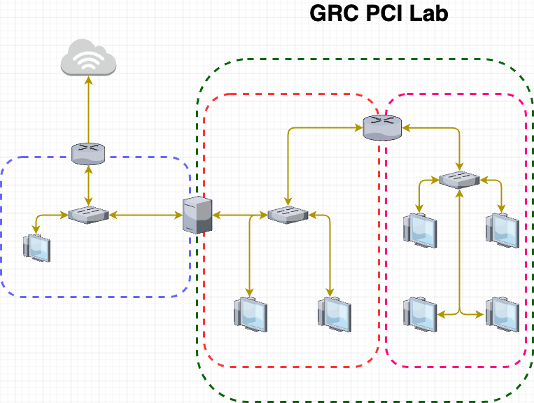

High-level Overview of GRC Automation Lab Topology using vSphere

GRC is thought to be **boring, bureaucratic, and uninspiring**, but it is a truly a **dynamic security discipline**, which requires professionals to develop a deep understanding of **business, products, colleagues, and customers to be successful**. I designed this lab to kind of teach me the ins and outs of the PCI framework, as well as gain the technical knowledge behind these different security controls. With compliance, it is more about the **context and discussion** around the control that matters. There is a lot of **information** that goes into whether or not a control is valid and will pass an audit. This is only part one of the series of blogs I want to create, in this case think of this one as a setup to understand what kind of controls are out there and how to setup services to gain that knowledge of an environment. 

By doing this lab I have gained the knowledge of technical setups of services, and then mapping it to the different PCI requirements. Understanding the requirements was easy enough but, also solidifying the evidence to satisfy those requirements helped sort of fill in the holes in my knowledge, as well as determine whether or not a control will be valid or not. I’m not going to lie this lab has gone through a lot of changes, since I think it was originally created with everything set up so, people can just remotely connect and collect artifacts. I will also be setting up the infrastructure and documenting how we are **gathering the evidence**, and the places that they are **accessed from**. I like doing this because, it also shows me the dependencies some artifacts may have, and GRC is a lot about identifying these dependencies and trying to streamline them so you have the evidence you need to be successful for an audit. 

I found this lab [https://www.cssia.org/grc-resources/](https://www.cssia.org/grc-resources/) from CSSIA, that walks through a home lab walking through high level PCI objectives.  Most of the uploads can be seen in the uploads folder (not sure if I’m suppose to have access to this lol) [https://www.cssia.org/wp-content/uploads/](https://www.cssia.org/wp-content/uploads/). As you may notice there are 3 requirements that are not included in this Lab, which are Requirement **#3 - Protect Cardholder Data, #9 - Restrict Physical Access to Cardholder data, and #12 which is Maintain a policy that addresses information security for all personnel**, which are unsupported for the Home Lab that I have setup. If you have any suggestions on how to mimic these requirements please, feel free to let me know. 

# Setup

---

You can view some of my old topologies [here](https://drive.google.com/file/d/1ZHX9Oehx5XCPQ4bRqYSEPBc8nmoqtKs0/view?usp=sharing), if you would like to use any of them, I exclusively use [Draw.io](http://Draw.io) for this. 

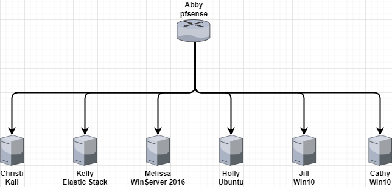

From here we see that we have a number of virtual machines that need setup, I decided to put everything behind a pfsense (the router) because, I am running an ESXI hypervisor and can segment this network from my actual home network. For logging this lab uses Kibana, but I will try to explore other methods as well throughout the labs. 

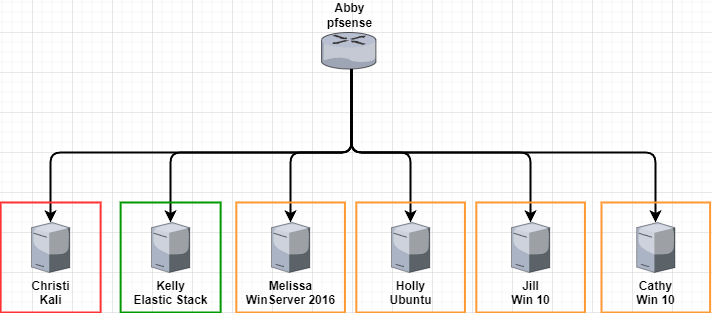

Here we see that red and yellow boxes: 

- Red boxes mean the auditor has access to these and how we are going to collect evidence from the environment.
- Yellow boxes are the sources of these logs, what we need to meet the PCI requirements.
- Green boxes represent our SIEM, and where we will gather evidence for these kind of controls.

Here you can see what I have for my physical setup. In a nutshell have an ESXI hypervisor installed on my **NUC (1.5 TB of storage, 32 GB of RAM)** and that sits on my home network. As you notice on the topology there is my home network in blue, that basically means I use the uplink on my NUC on the home network, and this is how I can access all my virtual machines. 

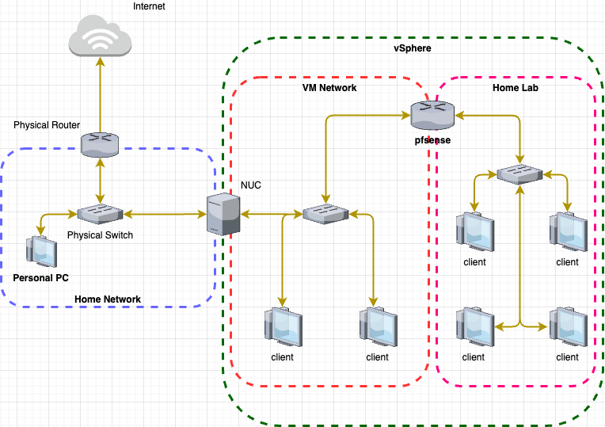

And as you may notice there are two different types of networks on the vSphere topology. The VM Network, think of it as basically the default network for VMs, these VMs sit on the same network as my home network so they can communicate directly with the Home network. The home lab, I have segmented off using a distributed switch, putting it in a different port group than the VM network. This means that devices on the VM network cannot communicate with the devices on my home lab. 

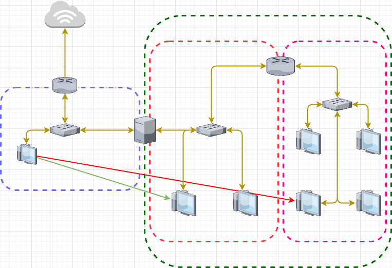

From the above figure, you can see which devices from which network can communicate with which devices. So in a nutshell: 

- **VM Network** → My home network, meaning when I spin up a VM in this network it get’s an IP from my Physical Network and sits on the same network as my physical devices
- **Home Lab** → Port group on my distributed switch that is not connected to anything but my pfsense, which also has an interface in the VM network so it is able to route all traffic to the internet, enabling my VMs to have internet access.

These are the general steps I took to make this lab as well as configuration I did on each machine to make this lab work. Most of the labs use default tools, but things such as setting up the SIEM and forwarding relevant logs was really important: 

## **Initial Setup/SIEM Tutorials**

---

Here are some guides to how I setup some of the vital parts of this lab. You will need a SIEM to collect logs, because that is the main source in which you will be gathering your evidence. Port forwarding to get the network traffic from end hosts, and also how to forward specific audit logs in Windows as well. 

[Installing Elastic Stack](https://www.notion.so/Installing-Elastic-Stack-b5fd046f3f014ba6b5482668d24cddb3?pvs=21)

[Installing Kibana](https://www.notion.so/Installing-Kibana-a5b62c9894df4129b44cb69f7ecb58fe?pvs=21)

[Forwarding Logs](https://www.notion.so/Forwarding-Logs-aad5992708464e788d4dfb1564cd402f?pvs=21)

[Port Forwarding in vSphere](https://www.notion.so/Port-Forwarding-in-vSphere-da3ed8a9c47a42d1b68c703447670f93?pvs=21)

[Setting up File/Folder Auditing on Windows 10](https://www.notion.so/Setting-up-File-Folder-Auditing-on-Windows-10-0f86b6405556459fbeeff660e342a74a?pvs=21)

[Setting up Nessus](https://www.notion.so/Setting-up-Nessus-51fc5fc3627a4e9eb4daf8ff148b707e?pvs=21)

# PCI Overview

---

I am pretty new to the **PCI framework**, my main work comes from things such as NIST and the CIS controls, so this one will be very targeted, as I am planning on making plans on how to meet each of these requirements in the lab. PCI DSS in summary is a global data security standard for payment cards, it has all the policies and requirements needed for an organization to be secure when processing, storing, or transmitting cardholder data. They can be categorized as the following: 

| **Goals** | **Requirements** |
| --- | --- |
| Build and Maintain a Secure Network | 1. Firewalls 
2. Default passwords  |
| Protect Cardholder Data | 3. Configurations on cardholder data 
4. Encrypt during transmissions  |
| Maintain a Vulnerability Management Program | 5. Regularly update software 
6. Develop and maintain Systems  |
| Implement Strong Access Control Measures | 7. Restrict Access 
8. Unique IDs 
9. Restrict Physical Access  |
| Regularly Monitor and Test Networks | 10. Track and monitor all network resources
11. Regularly test security systems and processes |
| Maintain an Information Security Policy | 12. Maintain a policy that addresses information security for everyone |

# 1.0 - Firewalls

---

Lab one is building, maintaining, and testing a workstation firewall. The mapping for PCI DSS 1.4 under requirement 1 is: 

> Install personal firewall software on any mobile and/or employee-owned computers with 
direct connectivity to the Internet that are used to access the organization’s network.
> 

In order to achieve this there are 3 requirements that also be met to fulfill 1.4: 

- Specific configuration settings are defined for personal firewall software
- Personal firewall software is actively running
- Personal firewall software is not alterable by users of mobile and/or employee-owned
devices.

### Testing Firewall Rules

This scenario, I will only be allowing port 22 and 3306 for SSH and SQL, because that is the purpose of this VM. In order to meet these requirements we will run an initial nmap scan: 

```
nmap -sS -T4 -p- -n --reason --script=banner <ip address>
```

Output: 

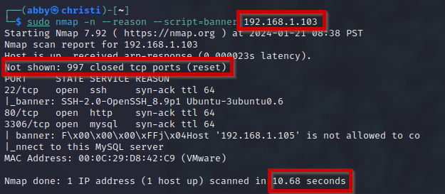

As you can see here we don’t get much out besides the `ignored states` and `reset` meaning that the firewall is not enabled, and we can confirm this running `ufw status` on Holly. From there we can see that there are 3 open ports: `22, 80, and 3306` each running their own service. We know that 22 and 3306 are SSH and SQL, while 80 is an Apache web server if we try to visit it. 

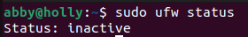

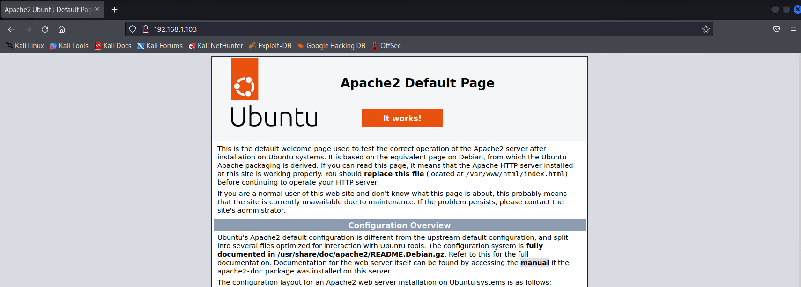

From here we can enable the firewall, and for the policy only allow port 22 and 3306 on there. 

- `ufw allow 22`
- `ufw allow 3306`

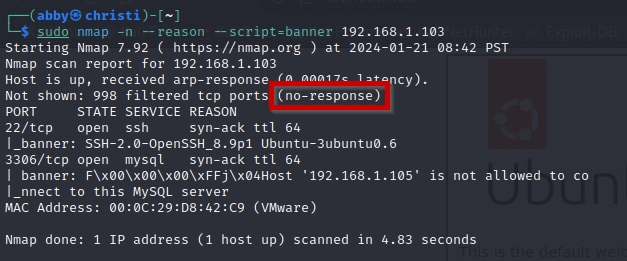

After running the scan we see that there is a no-response, meaning that the firewall is on and not allowing those ports to be scanned, and from there we can allow the ports that we want to be available on that virtual machine. 

# 2.0 - Default Passwords

---

This lab is mainly looking at if there are any default passwords/settings setup on the network. This is to meet the requirement PCI DSS Control #2: 

> Many routers or POS systems, come with factory settings like default usernames and passwords. Defaults make device installation and support easier, but they also mean that every model originates with the same username and password. Default passwords are simple to guess, and most are even published on the Internet. The problem is that third parties sometimes install hardware or software and leave merchants unaware that their entire system is protected by an easy-to-find/crack password. Vendors might also purposely leave weak or default passwords to make service easier. But, that’s like leaving your front door unlocked just to make life more convenient.
> 

This is especially important, as some people might think this is common sense it is easy to overlook this when you have a lot of machines on your network. In this case we use the `xHydra` tool to automate this and use password lists on GitHub to scan the network for any default credentials. So in order for us to meet these requirements we must: 

- Scan machines for default credentials
- Establish a baseline for configuring new devices, so that default devices are not configured on them
- Re-run the scan to make sure there are no default credentials that are usable

## Checking MySQL Default Credentials

Again, I have setup these services myself so I am fully aware of what has default credentials or not. If you want to see how I setup the lab please refer to my lab setup guide that will come after this post. Here we use `xHydra` to test the MySQL service on Holly for any default credentials: 

1. Open up xHydra: 

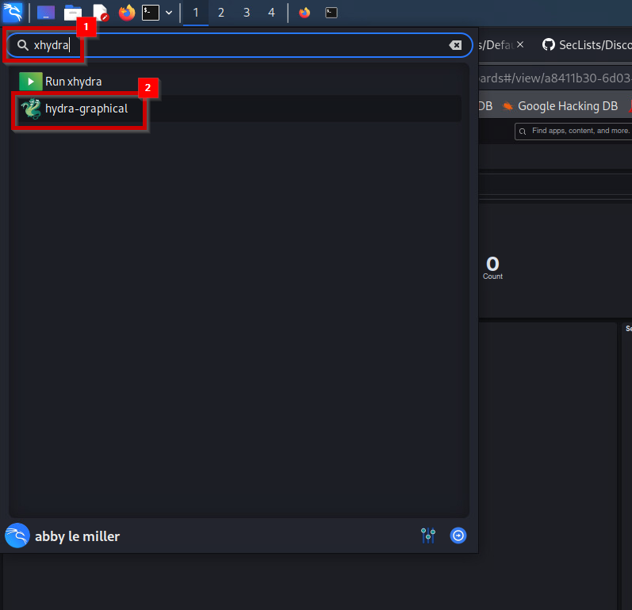

1. Configure the Target settings, somethings to note
    1. Single Target: Will be the IP address of Holly because that is where the MySQL server is being hosted
    2. Port: MySQL be default is on 3306, if you don’t  know which port refer to the initial nmap scan that we ran in Lab 1 
    3. Protocol: Protocol will be MySQL, this can be changed to other services if you want to test them for default credentials as well

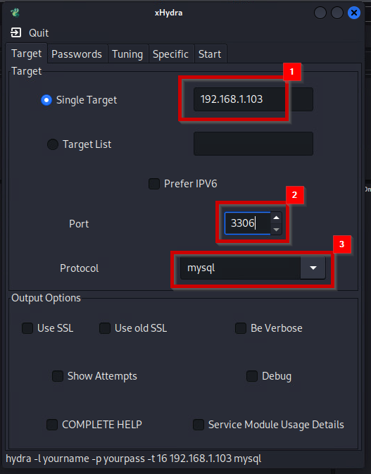

1. Now configure the password list that we would like to use. For this one, the lab uses just a default MySQL password list from github: [https://github.com/danielmiessler/SecLists/tree/master/Passwords/Default-Credentials](https://github.com/danielmiessler/SecLists/tree/master/Passwords/Default-Credentials) Download that then configure hydra: 

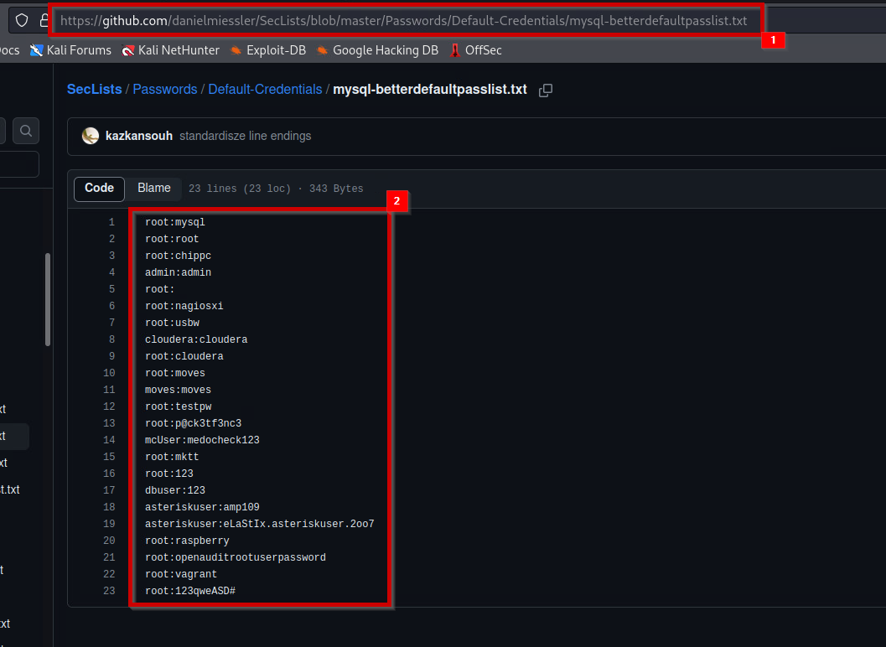

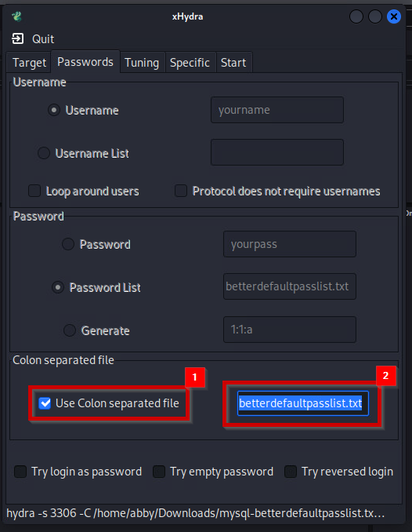

1. Then we press start and we see that the scan is running and we get the results show below: 
    
    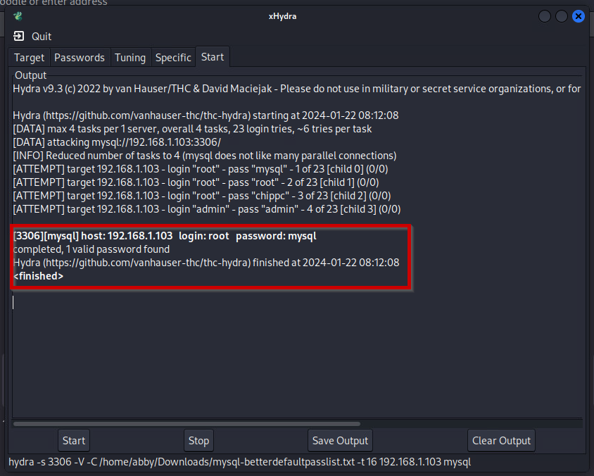
    

As you can see MySQL has a default password of public, and you can login as root. This means this does not meet the requirements for PCI, and we would have to run this scan again once the change the password, and make sure we cannot get in with default credentials. 

## Checking SNMP Community Strings

SNMP stands for Simple Network Management Protocol, and usually runs on port 161. SNMP facilitates network information sharing, and is important to gain the information of the devices on your network. It also has places where you can sign into, which will be explored here. Essentially what we are doing with the community strings is sort of brute forcing them. Community strings are basically passwords used to access statistics of a device such as a router, and we want to keep these safe so that malicious users can’t access them and try to find weaknesses given those statistics. 

We will be using the same xHydra program but, just configuring it differently:

1. Configure xHydra to brute force Community Strings:
    1. Password list can be found here: [https://raw.githubusercontent.com/fuzzdb-project/fuzzdb/master/wordlists-misc/wordlist-common-snmp-community-strings.txt](https://raw.githubusercontent.com/fuzzdb-project/fuzzdb/master/wordlists-misc/wordlist-common-snmp-community-strings.txt) 

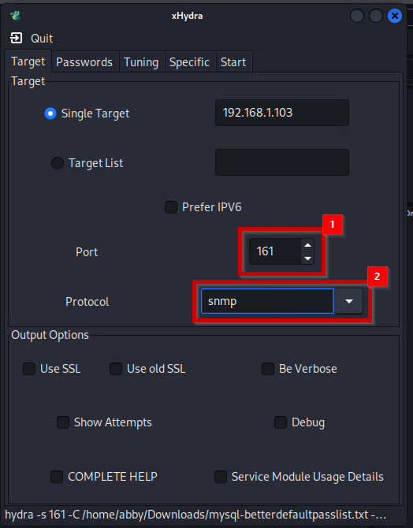

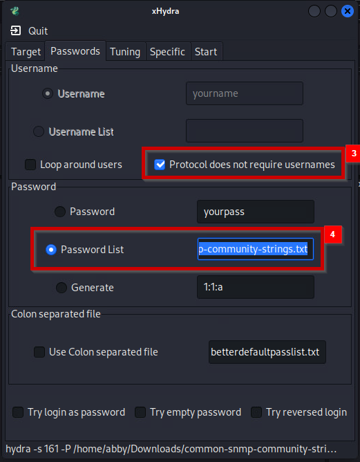

1. Output we see that we can login using the password public to view some device statistics. 
    
    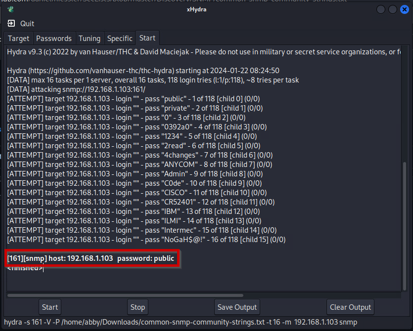
    

# 4.0 - VPN Configuration and Testing

**outdated because I switched to Kibana from security onion bc my home network died lol. The traffic forwarding can be pretty confusing especially if you don’t have port mirroring enabled.**

For this portion of the lab, it is described as `Encrypt and test the encryption of transmission of cardholder data across open, public networks.` in that strong security protocols should be used when transmitting cardholder data over public networks that could be intercepted by malicious users. 

In this lab we are checking whether or not hosts are using encryption when on the internet, for the sake of simplicity I will only be looking at if they are using SSL encryption, or just using port 80 and not encrypting their data, as well as remote sessions such as telnet vs SSH. I believe this lab only checks for http, and purely looks at the destination port and SSL encryption. 

**Requirement 4.1** can be described with the following: 

> Use strong cryptography and security protocols such as SSL/TLS, SSH or IPSec to safeguard sensitive cardholder data during transmission over open, public networks (e.g. Internet, wireless technologies, Global System for Mobile communications [GSM], General Packet Radio Service [GPRS]). Ensure wireless networks transmitting cardholder data or connected to the cardholder data environment use industry best practices (e.g., IEEE 802.11i) to implement strong encryption for authentication and transmission. The use of WEP as a security control is prohibited.
> 

Our POS (Point of service) is the Windows 10 box, and from there we can use Kibana to see which traffic is encrypted or not. How I generated the traffic can be described in this blog, as well as how I created Kibana to get these logs can be seen here, it is a whole separate process in its own. 

## Finding Unencrypted HTTP Traffic in Kibana

From Kibana we can check to see if there are any http logs, or any http destination port 80 traffic that was caught. In order to do this we do the following: 

1. Login to security onion, click on Kibana on the left hand side: 
    
    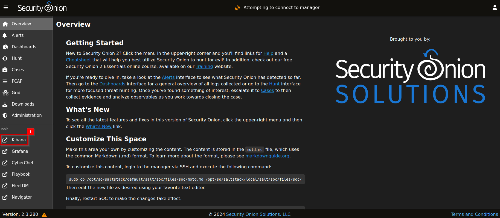
    
2. From here we can see our dashboard, with all our logs: 
    
    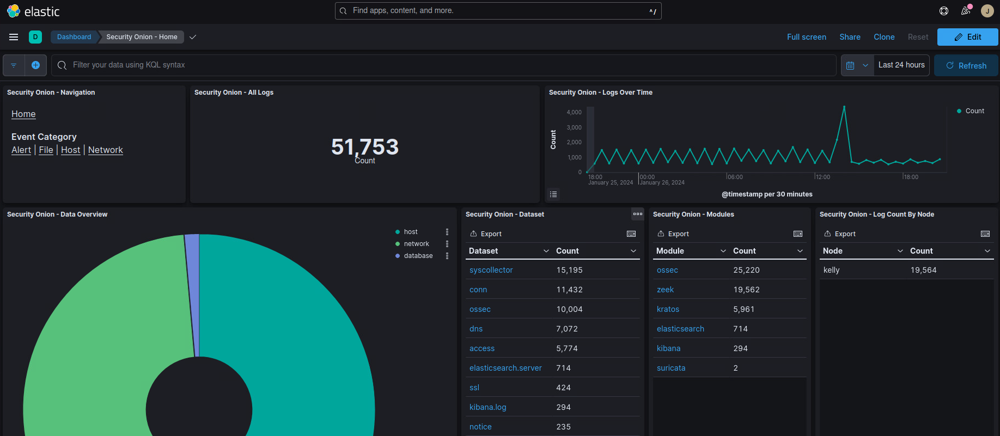
    
3. To check for destination port 80, we can add a filter like the following: `destination.port : 80` 
    
    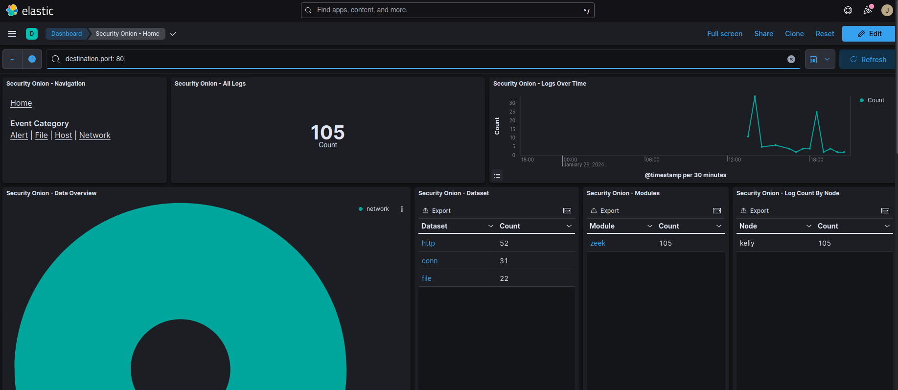
    
4. If we scroll down we can see the host devices that are making requests to another server on port 80, from there we know the POS is not following this requirement, which is 192.168.1.102, which is our Windows 10 box. 
    
    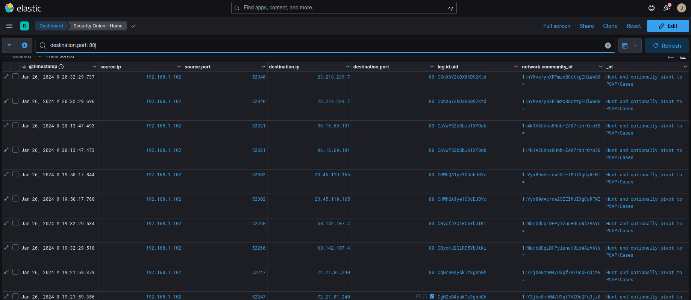
    
5. An alternative is that we can click the network action back on our original dashboard, which actually gives us more perspective on our systems: 
    
    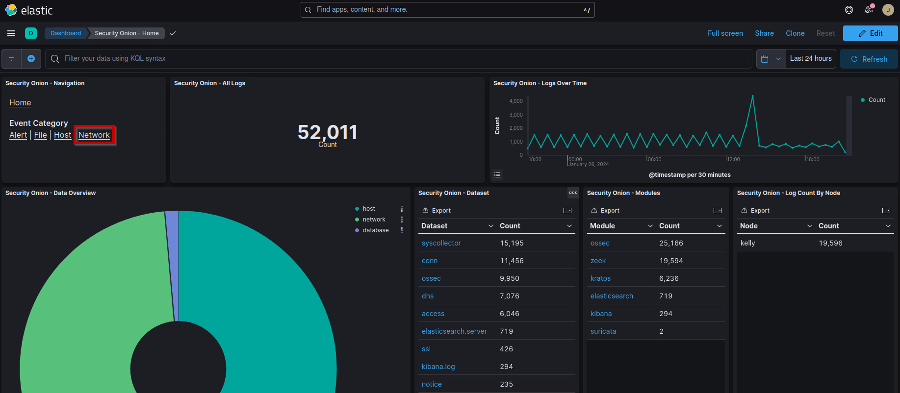
    
6. From there we can see our different protocols, and continue to investigate any unencrypted connections that were made: 
    
    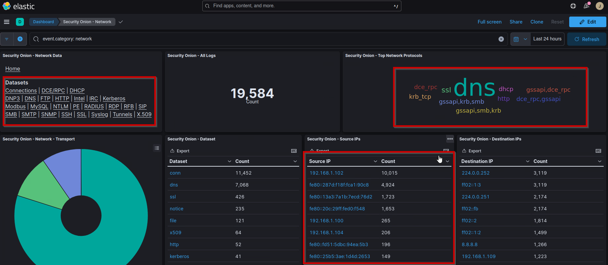
    
7. From here we can also look for FTP logs as well, and see if the traffic is encrypted or not as well.  
    
    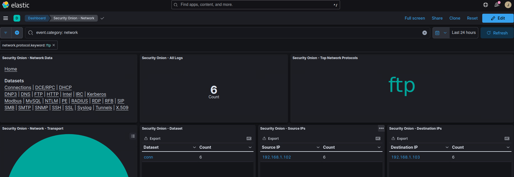
    

In order to remediate this, and fix it so that it is compliant, we must use `SFTP`, so that the traffic is encrypted, as well as ensure that `HTTPS` is being used when the POS systems are sending out encrypted traffic. 

# 5.0 - Antivirus and Malware Scanning and Compliance

In this lab we are purely **checking for Windows Defender on our windows system**, and making sure they are consistently updating our POS systems, as well as our Windows server. Here are the definitions for requirement 5: 

> 5.1 → Deploy anti-virus software on all systems affected by malicious software (particularly personal computers and servers).
> 

> 5.2 → Ensure that all anti-virus mechanisms are current, actively running, and generating audit logs.
> 

And we can meet these requirements by looking at Kibana. In order to do this, we must ensure that Sysmon logs are being forwarded to the elastic stack server. Make sure to reference the setup logs if you are setting up everything by yourself. 

## Checking Windows Defender Status

For the query we can look for win log event id of 5001, which means Windows Defender Antivirus has been disabled `winlog.event_id:5001` 

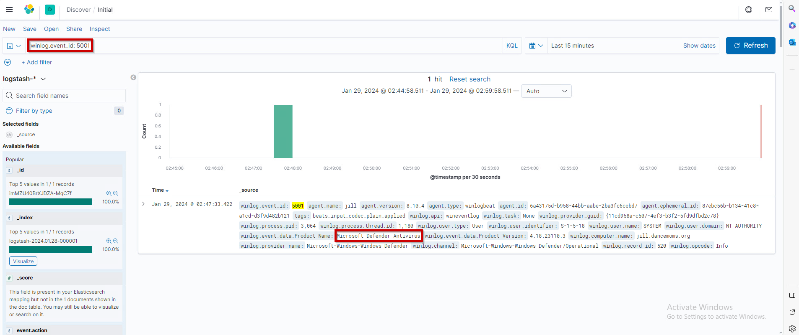

From there, we can see the message of what happened: 

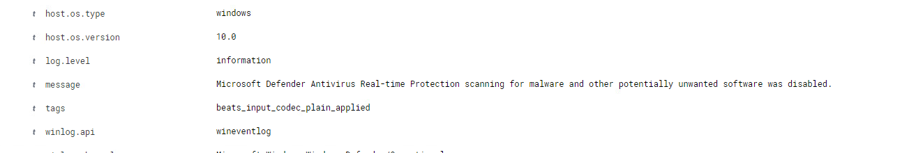

# 6.0 - Systems Updates, Patching and Compliance

In this lab we are also looking at regularly updating Windows as well, this can be done by looking at Kibana assuming you have everything setup as well. I strongly encourage you also build the lab from scratch too, it helped me understand where these logs are coming from and also how to ship it to a centralized place. 

**Common Window Log Event IDs:** 

| event_id | data.EventChannel.System.Message |
| --- | --- |
| 19 | Installation Successful  |
| 20 | Installation Failure: Windows failed to install the following update with error  |
| 25 | Windows Update failed to check for updates |
| 26  | Windows Update Successfully found # updates  |
| 31 | Windows Update failed to download an update  |
| 41 | An update was downloaded |
| 43 | Installation Started: Windows has started |
| 44 | Windows update started downloading an update |

## Tracking Windows Update Successes and Failures

From Kibana, we can use this query to check whether or not updates have been performed or not using the query `event.code` , then the specific code that we want to enter. For this example I will be using `winlog.event_id:19`  to look when the systems had successful updates. 

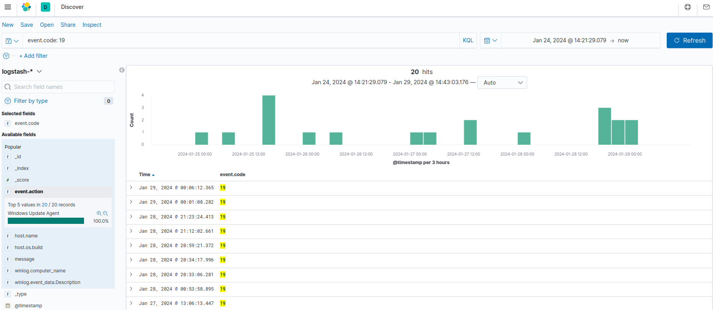

We can also use the query `event.code:20` to check for installation failures as well: 

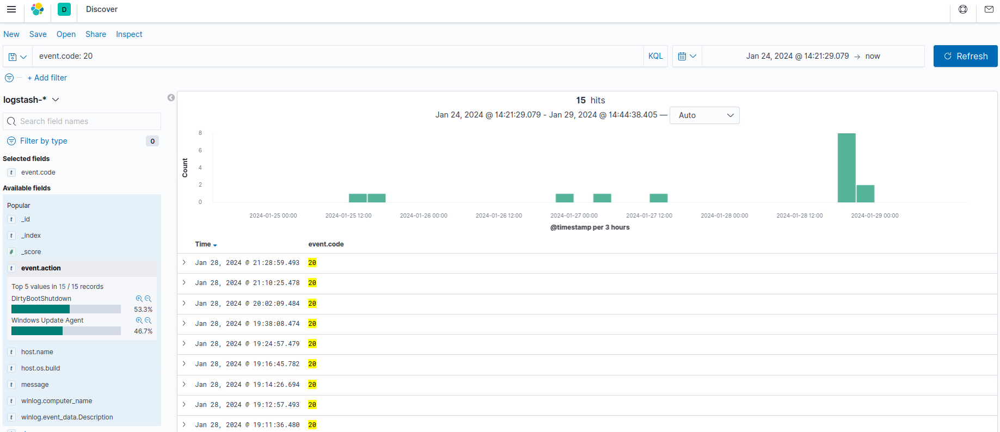

I know that my windows systems are only running Windows Update Client but, you can narrow it down even further with this query if you have multiple `event.provider.keyword:"Microsoft-WindowsUpdateClient"` . KB, which stands for knowledge base, allows you to search for specific updates as well. 

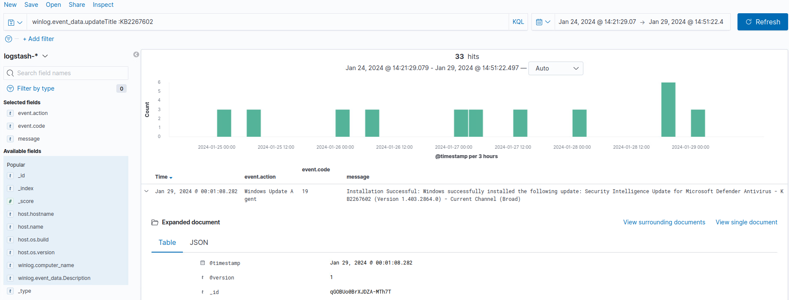

Here we search for an update from Microsoft Defender Antivirus, searching for the KB string in the title, you can also do this for any update that you might require, and cross-reference it to the machines that you have, or search for a specific update that is required for every host. 

# 7.0 - Access Control Detection

In this lab we will be logging files that have been edited and moved around, and if they are allowed to access that. Here are some sample event logs that we can view as well: 

| Event ID | System Message |
| --- | --- |
| 4656 | Access object fail  |
| 4658 | Handle to an object was closed |
| 4660 | An object was deleted |
| 4663 | An attempt was made to access an object |

## Reviewing Windows Object Access Logs

Update after rebuilding the lab, starting with a fresh kibana and windows server I was able to get the logs to appear. 

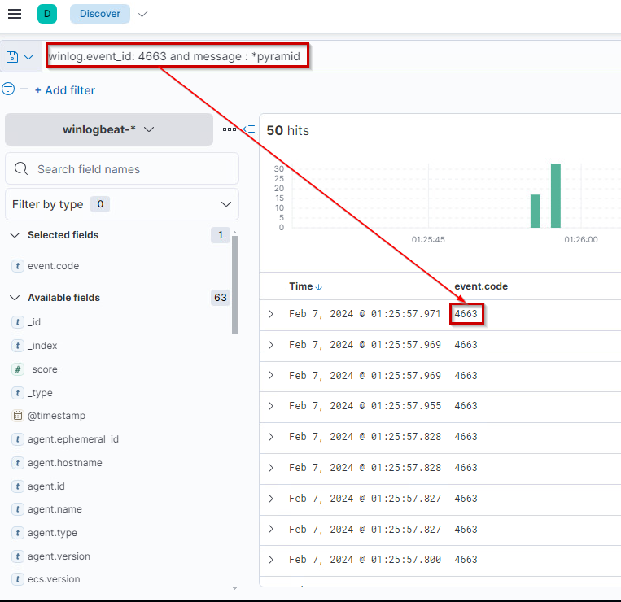

The query I used above is `winlog.event_id: 4663 and message: *pyramid` which basically means look for this event id and if it has this message of the pyramid or whatever content you want to check is being accessed. We can expand the message part of the log to see what object was accessed: 

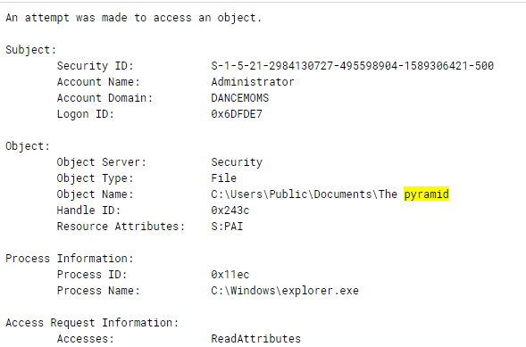

# 8.0 - Implement Access Control Systems and Compliance

This requirement delves into user authentication, and the security measures around it. Having the necessary policies and security measures in place is a must to ensure that users are authorized appropriately. For requirement 8, it can be seen as the following: 

**8.1 →** Every user MUST have a unique user name BEFORE they can access any system components OR cardholder data 

**8.2 →** Employ at least ONE of these for authentication: 

- Password/Passphrase (Something you know)
- Token device or smart card (Something you have)
- Biometric (Something you are)

**8.3 →** Employ 2FA for remote access for employees, administrators, and third parties. 

**8.4 →** Render all passwords unreadable (using strong cryptography) during storage and transmission, for all system components 

**8.5 →** Ensure proper user identification and authentication management for non-consumers users and administrators on all systems 

In this lab we will be focusing on requirement 8.2, specifically these ones: 

```
8.2.3 Passwords/phrases must meet the following:
• Require a minimum length of at least seven characters.
• Contain both numeric and alphabetic characters.
Alternatively, the passwords/phrases must have complexity and strength at least equivalent to the parameters specified above.

8.2.4 Change user passwords/passphrases at least every 90 days.

8.2.5 Do not allow an individual to submit a new password/phrase that is the same as any of the last four passwords/phrases he or she has used.
```

For this we will be using the Microsoft Security Compliance Toolkit to use GPOs to the Local Security Policy and Registry to ensure it is compliant. So essentially what we’re looking for is: 

- Password Length > 7
- Password Complexity = 1
- Maximum Password Age < 90
- Password History Size > 4

## Auditing Windows Security Policies

For this lab we will be using a Microsoft tool to check the policies on the system. We can actually this in binary format in `C:\Windows\security\database\secedit.sdb` . 

1. Get the version of your system. We can do this by running a PowerShell command `systeminfo` 
    
    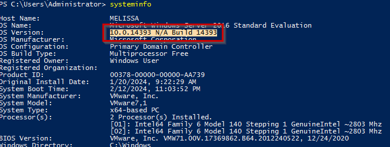
    
2. Now we can install the [Security Compliance Toolkit and Baselines](https://www.microsoft.com/en-us/download/details.aspx?id=55319) named the `Policy Analyzer` .
3. Then we can run the PolicyAnalyzer on here: 
    
    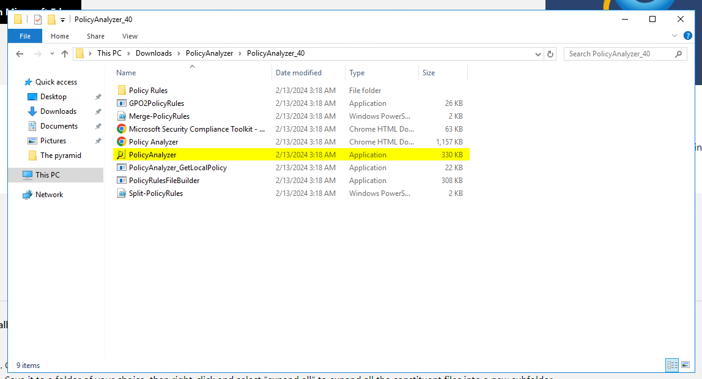
    
4. Then we get this GUI, in order to actually use different policies, we have to use the sample policy rules in the Policy Rules folder and put it in the following paths.Then we can select which policy to compare with and then compare it to the effective state of the machine.
    
    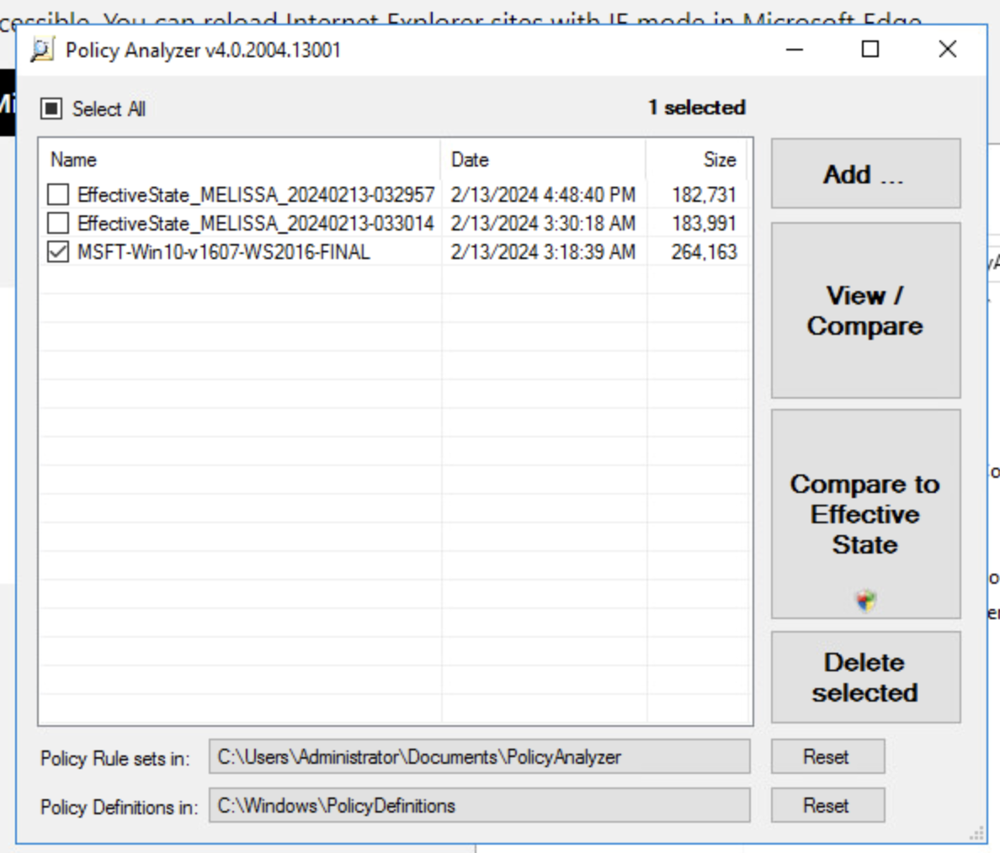
    
5. Then we can see which policies are successful or not compared ot the effective state of the machine: 
    
    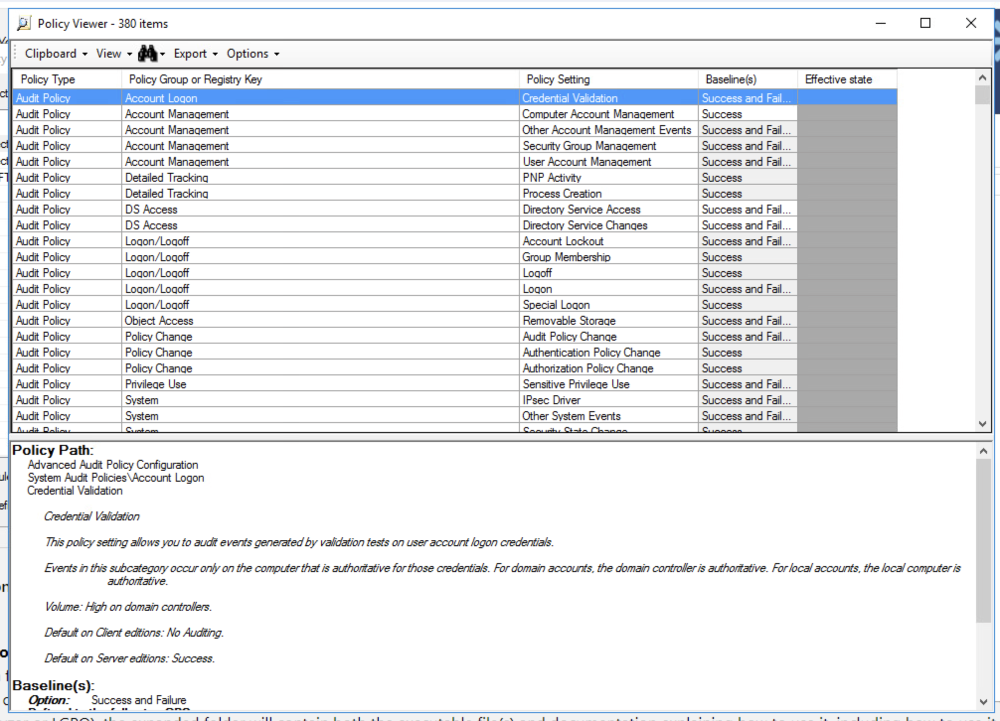
    

# 10.0 - Log Management and Compliance

The main objective of this lab is to prove that we are **regularly recording, tracking, monitoring and testing** all access logs to network and workstations. This will be accomplished with the instance of Kibana that we have, and by looking at the different event codes to determine who has logged in and who has failed to login. 

> 10.2.1 → All individual user accesses to cardholder data.
10.2.2 → All actions taken by any individual with root or administrative privileges.
10.2.3 → Access to all audit trails.
10.2.4 → Invalid logical access attempts.
10.2.5 → Use of and changes to identification and authentication mechanisms—including but not limited to creation of new accounts and elevation of privileges—and all changes, additions, or deletions to accounts with root or administrative privileges.
> 

For right now I only have my Windows 10 and Windows Server 2016 forwarding logs to the Kibana server. 

## Tracking User Logons and Logoffs

We need to pull the necessary information in order to identify and represent the logon process for when a user logs in. This can be represented by: 

- Logon Time
- Logout time
- Login locally or remotely
- Was this a standard user or admin

Flow: 

EventID: 4624 (Successful Login) → Event ID: 4627 (Group Membership Info) → Event ID: 4647 (Logoff)

Common Logon session events: 

| event_id | message |
| --- | --- |
| 4624 | Successful Logon  |
| 4625 | Failed Logon |
| 4627 | Group Membership Information |
| 4634 | Log off  |
| 4647 | User initiated Log Off  |
| 4672 | Special Privileges assigned to new Logon |

| LogonType | Event Code |
| --- | --- |
| Successful Local | 2 |
| Successful Remote  | 10 |
| Failed Remote | 3  |
| ElevatedToken | %%1842 |

For this lab we will be looking at three things: 

- Successful Logins
- Failed Logins
- Administrative Logins

And also make sure the following policies are being followed: 

1. Only the Administrator account should be able to login locally to the Windows Server 2016 Server
2. Too many failed logon attempts should be looked at as a potential at attack 
3. Only the administrators should have administrative privileges 

Now we can start gathering the evidence, knowing the different IDs for login and the types of logins as well. 

1. Your dataset might need to go back a little further, but this is what I get when I filter out for only event codes for successful logins, such as `4624` . As you can see we get a lot of different hits since we are looking at 2 systems and I’ve been logging in to them. Full query: `winlog.event_id : 4624` . 
    
    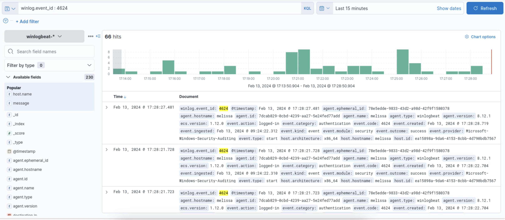
    
2. To look at the failed logins, we would just look using the other code `4625` . 
    
    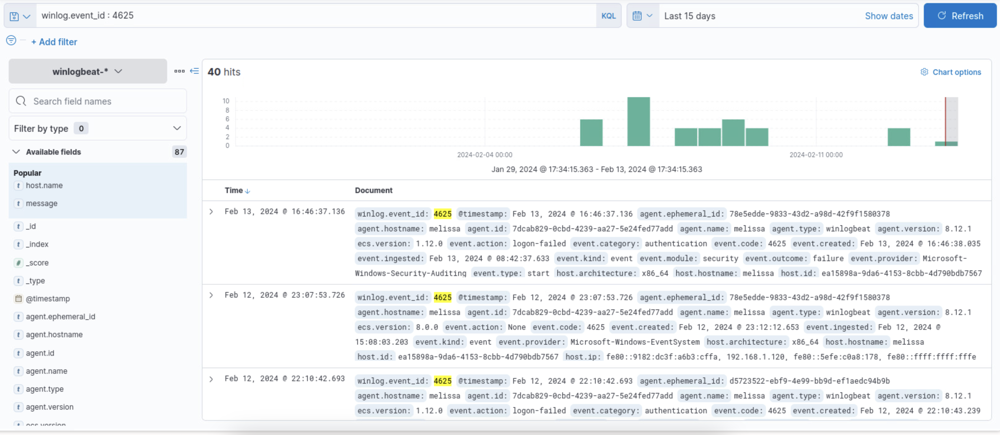
    
3. To look for administrative logins, it’s a little trickier. In order to know whether or not they are an administrator, we would have to look at the Elevated token attribute in the logs. The full query is: `winlog.event_data.ElevatedToken : %%1842` 
    
    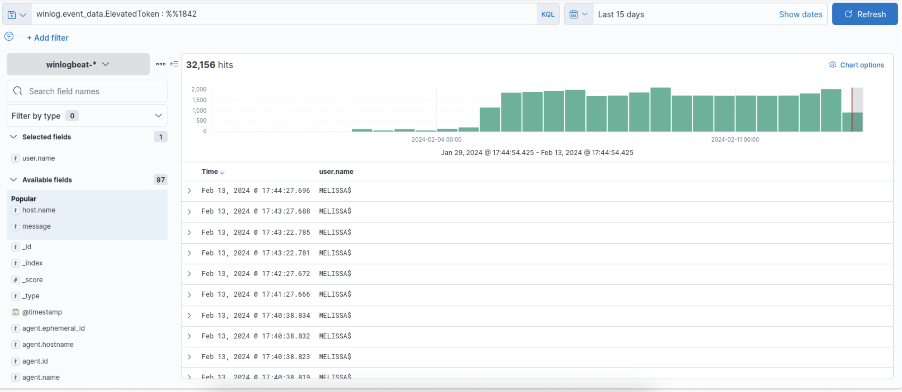
    
4. Now that we know some of the filters, we can look at some of the policies that we have in hand. The first one is that the administrator account should only be able to login locally to windows server 2016, no other account should be able to log in. To ensure this, we could look at the local logins, using the login type filter. For this example I used `winlog.event_data.logontype : 2` , that looks for all local logon attempts, if we wanted to just see the successful and failed ones we would use the codes in step 1 and 2 for that. 
    
    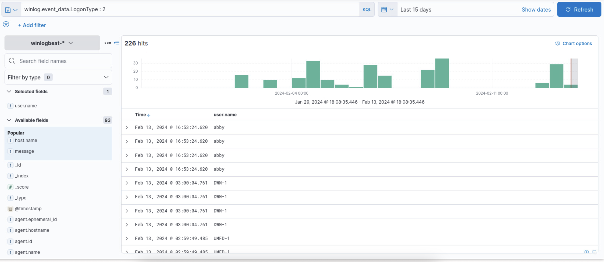
    
5. Now this gives us a lot of information but, for this policy we are specifically for the Administrator account, in order to do that we can look for the target account and look for the the `Administrator` account. And we can just add the `user.name : Administrator` account to look for the Administrator account, and then add another column to show whether if it was successful or not. 
    
    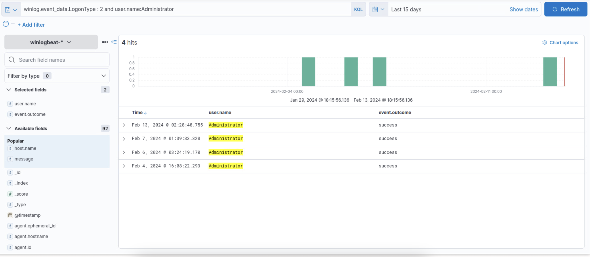
    
6. Now that’s great and everything but, if you notice from step 4, there were a lot of accounts that were trying to sign in and do stuff, so we have to see if anyone BESIDES the administrator were able to login successfully. And we can do this just by adding a `not` operator in front of the username. And as we can see from the screen shot below, there is a user `Abby` that is logging in successfully into the server. In turn we would disable that account. 
    
    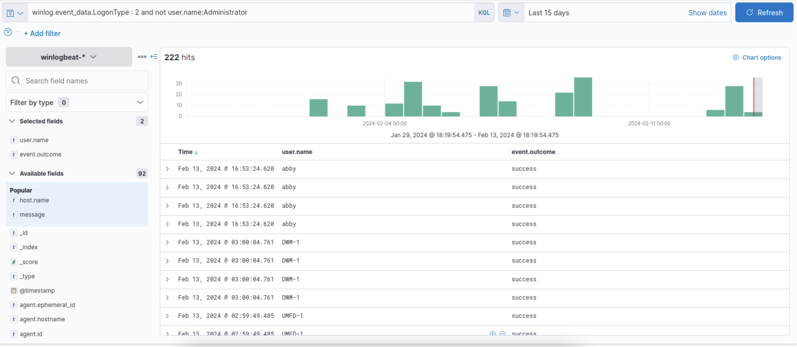
    
7. Now we can look at the amount of number of failed attempts for a login. And we can do this with the `4625` for the code value. As you can see from the below screenshot we are thrown a lot of information so, we need to narrow down the results so that we can effectively understand it.
    
    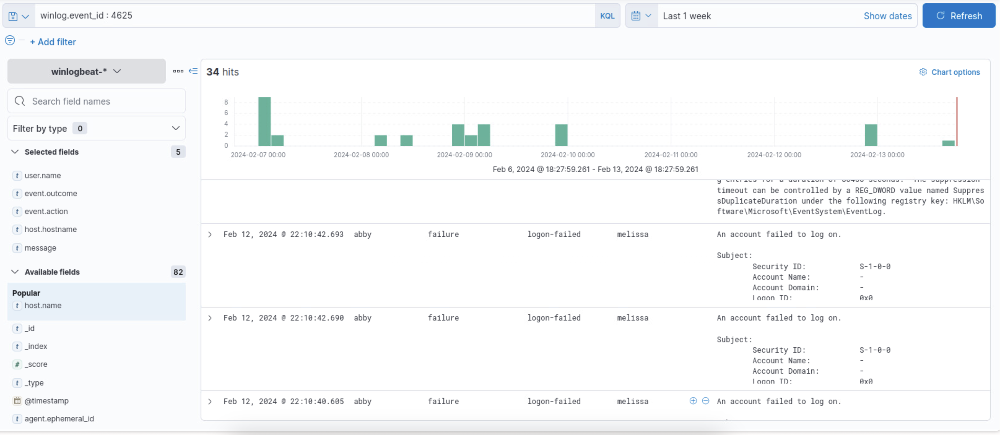
    
8. We can do this by looking at how many failure logs each user has on the side: 
    
    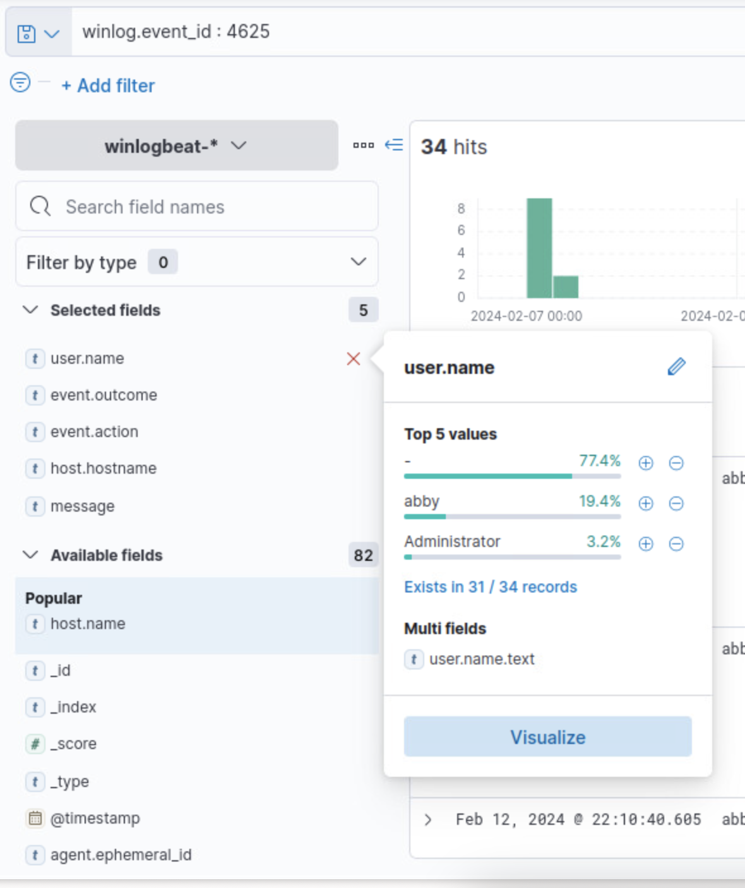
    
9. Now we can see that Abby makes ~20% of the logs, meaning abby failed her login attempts quite a few times, so we can investigate further and see if there are any patterns for the amount of times Abby has logged in, for example if there are an abnormal amounts of login attempts consecutively, or if she tries to login at an abnormal time such as 2am or non-working times: 
    
    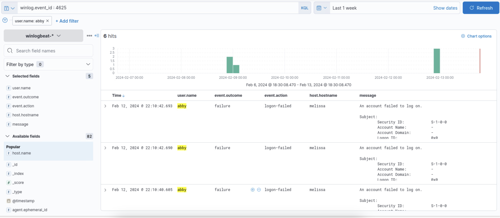
    
10. From there we can see Abby has literal milliseconds before each attempt, so we can assume that someone might have been trying to perform a brute force attack.

# 11.0 - Regularly Monitor and Test Networks

In this lab we will be looking at PCI 11.0 requirements which can be summarized as `Regularly monitor, evaluate and test security systems and processes` . The full PCI_DSS Mappings is given as: 

> **11.2** **→** Run internal and external network vulnerability scans at least quarterly and after any significant change in the network (such as new system component installations, changes in network topology, firewall rule modifications, product upgrades).

Note: Multiple scan reports can be combined for the quarterly scan process to show that all systems were scanned and all applicable vulnerabilities have been addressed. Additional documentation may be required to verify non-remediated vulnerabilities are
in the process of being addressed. For initial PCI DSS compliance, it is not required that four quarters of passing scans be completed if the assessor
> 
> 1. Verifies the most recent scan result was a passing scan
> 2. The entity has documented policies and procedures requiring quarterly
> scanning
> 3. Vulnerabilities noted in the scan results have been corrected as shown in a rescan(s).
> For subsequent years after the initial PCI DSS review, four quarters of passing scans
> must have occurred.

> **11.2.1 →** Perform quarterly internal vulnerability scans and rescans as needed until all "high risk" vulnerabilities (as identified in Requirement 6.1) are resolved. Scans must be performed by qualified personnel.
> 

To gather the evidence we will be using Nessus, so if you don’t have that setup I reccomend you do that now hehe

## Running a Nessus Vulnerability Scan

In order to gather evidence we will be performing an advanced scan on the network, make sure you have a Nessus instance. 

1. First sign-in to wherever you have the instance running: 
    
    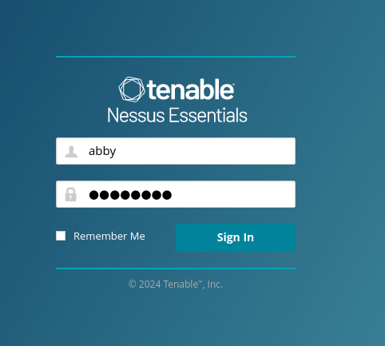
    
2. Then we can click on a new scan, if it is grayed out plugins might still be installing. 
    
    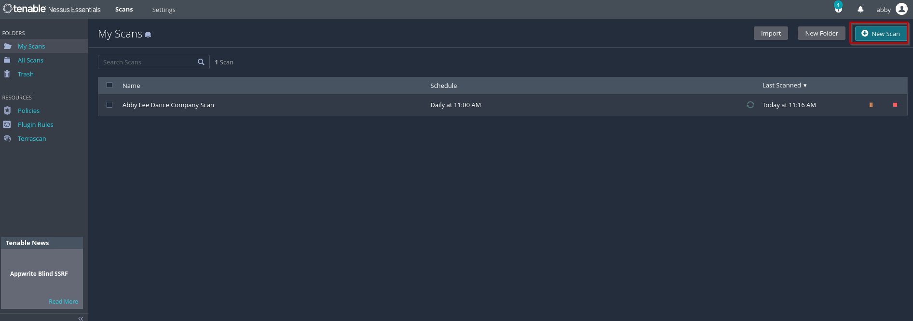
    
3. From there we can configure our scan the network on a regular basis, in this case I will be doing it daily, doing an advanced scan and scanning the subnet that I am currently on. 
    
    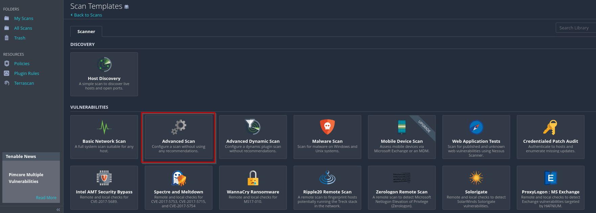
    
    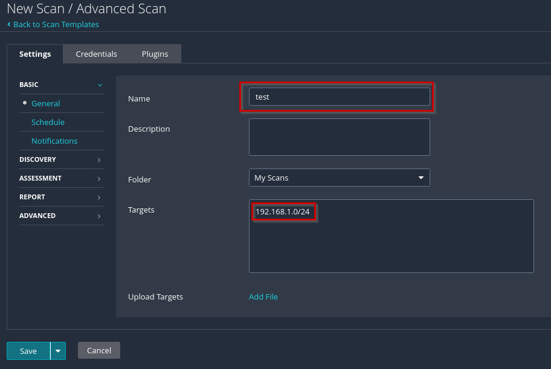
    
4. Now we wait for the scan and look at the results of it, and we can see that the Scan is done with the little green checkmark on the right hand side: 
    
    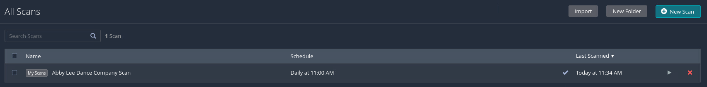
    
5. From here we can see the different amount of scans as well as their severity level of them and on which hosts they are on. This is great because, we can then prioritize these risks based on the severity level. 
    
    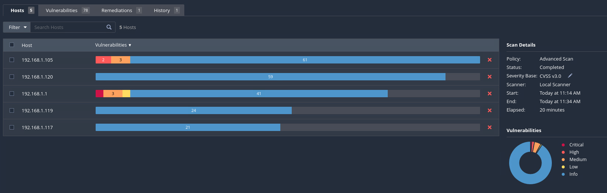
    
6. If we click on the Vulnerabilities tab we can get more information on each vulnerability that was found. I filtered to put the most severity on top descending to the least severity, which is why you see critical at the top. From here we can gain more information about the vulnerability and how to patch them. 
    
    
    
7. IF I look at the medium severity that I have, we see that our NTP server is responding to code level 6, and people can exploit that to become a DDOS attack on it: 
    
    
    
    Since this is on my pfsense, we can go in and disable it so that notification does not come up anymore.
