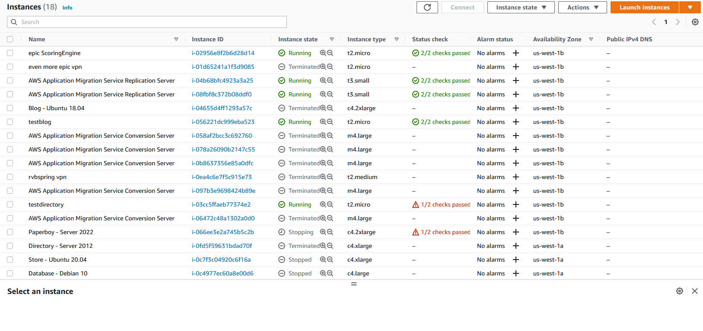
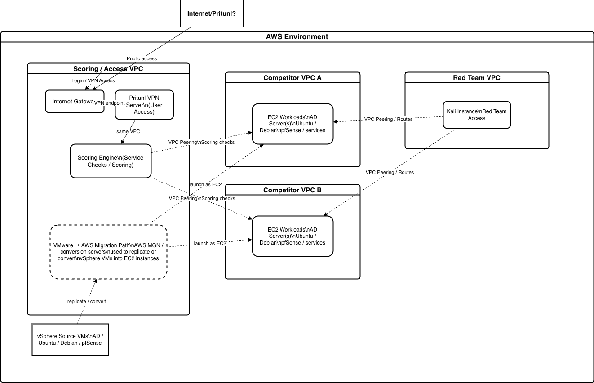

Now, this is a really interesting write up, as now I am writing about something that happened in November 2022 during my freshman year of College. I have like real adult problems and stuff like mortgages and shit and a child, thinking back on my experience on college, my biggest regret/turning point that helped me the most in my career was most likely my biggest fail. Please note I am raw dogging this lol, trying to recall what I did haha. 

This blog will go over how I bankrupted my cybersecurity club, and almost caused an immesurable amount of debt that a couple of college students living on pennies should NOT have. 

For context, our Cybersecurity Club (SWIFT) used to run Red vs Blue events, where students will test their mettle against an active red team, and harden host machines that are inheritly vulnerable once blue team is thrown in to it. Traditionally we would run this event through vSphere, where students could VPN in and access the environment. The problem with this is that vSphere gets pretty slow when multiple students were logging in. The solution me and the VP of operations of the time thought of was AWS! 

So the environment would be used on AWS where a Pritunl VPN connection profile would be used to login to the environment. Nothing could go wrong right? Wrong. 

Before the event, I had these cloudformation scripts that would automate the creation of the virtual machines as well as VPCs so that the scoring engine could reach it. Right off the bat though there were a 2 challenges: 

# 1. vSphere → AWS Migration

In November 2022, about two weeks before the competition, while balancing school and CCDC and shit, we needed to figure out how to get the environment onto AWS. We already had the virtual machines in vSphere, how could we migrate them to AWS? vSphere and AWS have different base images, and we would be unable to recreate the images within AWS (thinking about it now, may have been better to have the development again). From what I gathered there were a few AD servers, an Ubuntu host, a Debian, and perhaps a pfsense. Looking at resources now it looks like they are well supported: [https://aws.amazon.com/blogs/mt/migrate-vmware-virtual-machines-to-amazon-ec2-with-the-aws-application-migration-service-replication-agent/](https://aws.amazon.com/blogs/mt/migrate-vmware-virtual-machines-to-amazon-ec2-with-the-aws-application-migration-service-replication-agent/) but I remember having to deploy some of the Migration Conversions servers on AWS and convert a vMware template to something that AWS can deploy. This was inspired by Aaron Diaz who helped me migrate these instances from vSphere to AWS by providing me with that service. 



# 2. Notworking

Still before the competition, we have the VMs great, but how would the networking work between all the different VPCs? And how would the scoring engine talk to each VPC/where would Red team come from? This was much easier to resolve due to VPC Peering and just attaching Internet gateways so that users could login through the pritunl server that sits within the same VPC as the scoring engine. Each red team kali were in its own VPC, able to connect to each of the competitors VPC. 



Note the above is what I had in my dream one night when I was reliving this nightmare, some of it may be inaccurate, I’m pretty sure we used Pritunl for access to the environment but thinking now they could have also used the public IP Addresses. That brings me to the third issue that we ran into. 

# 3. Computers no likey pritunl

Pritunl was kind of funky, these were school computers so they were like blocking outbound connections to AWS. I think only one team was able to login lmao. After trying to put out fire after fire throughout the competiition period, i looked at the billing and came to see our next VERY big issue. 

# 4. Uh oh

<!-- Image missing from source archive: How%20I%20bankrupted%20my%20Cybersecurity%20Club/image.png -->

Oh great how did this happen. The AWS migration/deployment accidentally used provisioned IOPS EBS storage instead of general-purpose EBS. Great LOL. A breakdown can be seen in the below: 

```bash
Feb 1–20: about $1.99/day
Feb 23: $70.07
Feb 24: $173.73
Feb 25: $396.59
Feb 26: $488.09
Feb 27: $776.50
Feb 28: $700.78
Total February: $2,655.59
```

HAHA, that is 2/3rds of tuition. Luckily my glorious president was able to front it and we were actually able to get it waived, as I begged on my knees to AWS to waive the billing as it was an honest mistake haha. 

# 5. How to avoid this?

Pretty easy to avoid it, I think i tunneled vision but, you can set hard budget requirements, and the migration from vSphere to AWS is more supported as well. Also terraform is definitely better, at the time I only knew about cloudformation haha, so it did not go as well. Architectually wise, I think it was fine, Terraform also would have helped map out what it needed. 

In short, my notes from years ago say the following:

```bash
EC2: small instance types unless proven otherwise
EBS: gp3 only
EBS delete_on_termination: true
Snapshots: disabled unless needed
NAT Gateway: avoid if possible
Elastic IPs: minimal
Load balancers: avoid unless needed
CloudWatch logs: short retention
S3: lifecycle expiration
Everything tagged with event and teardown date
```

Which is a lot more doable through terraform. Man I really wish I still had the cloud formation scripts somewhere lol. 

# 6. A cautionary tale?

Yes in a way, I still have nightmares over this, but it was better for me to do this at a student club rather than at work. I was very lucky enough to be surrounded by people that supported me and helped build me back up and get back on my feet after and get this waived. They still talked to me after which is crazy. Thinking back, its not that bad, but at the time I thought it was the end of the world. But the great thing about this is that the worse thing had happened to me, and I still got out of it, and that helped me take bigger risks not only in my Cybersecurity career but in my life as well. I would not have the friends that I have now if I didn’t take those leaps of faith and risks (although make them more calculated). 

Guess the morale of this story is that fear is your worst enemy, and it shouldn’t be the reason why you don’t do something. For me I was fearful of a lot of things, like if I did take this risk, and it costed too much, I would be seen in a negative way. It was quite the opposite, I got a lot of respect and appreciation for my efforts, and I also had a great story to tell in my interviews.
