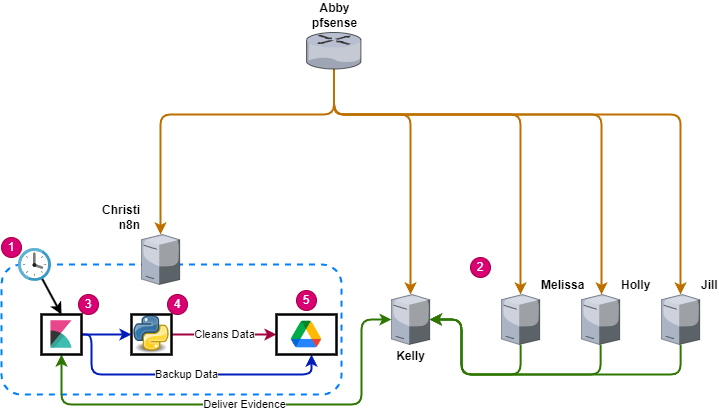

## GRC Engineering — Automating Evidence Gathering

[GRC Automation Lab setup](/2/)

By Jacob Jayme

**WORK IN PROGRESS**

You can read more about how I built the environment [here](/2/), such as setting up the Elastic Stack, Port Forwarding, AD, etc, the basics to understanding an environment. (Please read it I put a lot of effort into it 🥺) 

[GRC Automation Lab](/2/)

[Nathan (n8n)](https://app.notion.com/p/Nathan-n8n-9feb59a1b2ad4a01a38a366306eca29f?pvs=21)

[APIs ](/lab-notes/evidence-automation/apis/)

# Table of Contents

# Introduction

**What should I work on and why?** GRC data can be available in infrastructure and engineering so it can enable teams to make informed decisions or reduce their uncertainty on things. Which is the point of this lab, to show how we can centralize this kind of data and communicate it effectively to a business. Data driven actions essentially, given the environment that we have. 

**How does this play a role in GRC?** From my research on GRC as well as my Software Engineering, Blue-teaming experience, GRC has the potential to be an enabler of business activities, that can be used continuous delivery on the state of compliance of the company which in turn can provide a reduction of uncertainty to enable the company to take more risk or less. It enables the business to do more or pull back and say we need to focus on this. 

So now that we identified all the **artifacts/evidence** that can be obtained on the network, how do we **communicate that effectively with an audit?** As you may have noticed there were only 9 out of the 12 artifacts we were able to obtain, and there are still even more that I haven’t even touched on. This is where n8n comes into play. n8n is a workflow automation tool, historically used for detection engineering that can help us centralize our artifacts in a certain place. While there is still the extra step of also putting meaning behind that data, that will be the next step, for right now it’s just centralizing all this data in a way that compliance can understand them and perform audits efficiently. The way this walkthrough is structured is that I will attempt to automate the gathering of each artifact for each requirement in 3 steps.

1. **Ingesting the Data:** In order to communicate effectively what is on the environment, which sources can we pull from in order to do that? Such as scanners, logs, interviews, etc. 
2. **Uploading the Data:** How will we move the data to another platform? How do we centralize that data in a way for people to see it and understand the state of the businesses compliance at a glance? 
3. **Understanding the Data:** How do we tell a story with this data, again how do we give stakeholders, higher up business people a glance into what needs to be prioritized and what needs work? 

It is also important to mention that there are 3 types of data we can have for an audit: 

1. **Interviews:** Interviews are a way for auditors to talk to someone on the team. They are mainly just filling out a spreadsheet and will provide you with the questions they will ask based on the framework and the System Security Plan (SSP).  
2. **Testing:** Actually testing the control, so for example if you had a Media Protection Control and it asks how you protect from things such as mounting a USB you would ask to see to mount a random USB and if it gets denied it works. 
3. **Documentation:** Seeing the documentation from the client and making sure they have it, kind of like administrative controls.  

# Architecture

For this part of the blog, I will be attempting to automate the artifact delivery of Kibana logs to google drive but, you could easily upload to an S3 bucket and what not. This is the first step of my process just to get my hands dirty with Kibana and such. 

Artifact Delivery High-Level Overview

As you can see from the topology above, there are a lot of things happening. If you are not familiar with the setup I have on my lab that is okay, it is essentially a virtual environment that I have segmented off from my network, if you want more information on how I created the sample data such as User authentication, logins, etc, **please refer to my GRC PCI Lab** that is linked in the intro section. 

From the numbers in the diagram these are the steps: 

1. n8n runs a scheduled task, this is the trigger. This enables us to have continuous monitoring of data by having a sequence of events that would usually be done by a GRC analyst or someone on the team to be automated. 
2. Logs are being forwarded to the Kibana instance on the network. Now this can be on the cloud and stuff but for now they are on the same network for simplicity sake. 
3. n8n runs a Kibana node that is essentially just an API call to the Kibana instance, that get’s it from Kelly, so we can run specific queries from there. 
4. We have a python node to essentially try to clean that data and determine the control passes or not. Refer to workflows at the bottom of this page for examples. 
5. Upload to google drive with a pass or fail so people know if they passed or not. 

**The colors also have significance**, believe it or not, and also help describe the scope of the data as well. The blue dashed spot represents the n8n workflow. These are the sort of chain of commands that we can put together to efficiently gather and send data to different places. Then we also have the yellow arrows which just represent the connections between the devices, meaning they are all on the same network. Then we have the green arrows which represent the transmission of data, there are two parts. The first one is the **n8n instance** communicating with Kelly, which is our **Kibana instance** as well, and the second one are the **log forwarders from hosts systems**: Melissa, Holly, and Jill. 

So now let’s break down the diagram into 3 simple steps: 

1. **Ingesting:** Is the trigger, so far we have it on a scheduled task, so every week, n8n looks at Kibana and asks for the necessary logs for the audit. In this case we are hitting requirements 5-7, which require Kibana logs as evidence to satisfy the requirements. 
2. **Uploading:** The second step is n8n calling out to Kibana using the RESTful API. This is the equivalent of just putting the query in Kibana but, we have a way to transfer it to other places. At the same time we store this response in google drive. 
3. **Understanding:** The third step is python looking at that data and then cleaning it so that it is presentable, and there is a lot less fluff and unnecessary information in the logs that we obtained. 

Now time to get into the technical details. The great thing about n8n is that it is GUI based but, that does not mean you have to not know how to code. Although you do not need to know very heavy Computer Science concepts you must be able to troubleshoot and understand code from a glance (which n8n makes very easy) 

# Workflows

---

[Example Workflow with Kibana](/lab-notes/evidence-automation/example-workflow-with-kibana/)

[Example Workflow w/ Nessus](/lab-notes/evidence-automation/example-workflow-w-nessus/)

[6.0 - Develop and maintain secure systems and applications](/lab-notes/evidence-automation/6-0-develop-and-maintain-secure-systems-and-applications/)

[10.0 - Track and monitor all access to network resources and cardholder data ](/lab-notes/evidence-automation/10-0-track-and-monitor-all-access-to-network-resources-and-cardholder-data/)

[Automating Compliance in AWS w/ Terraform ](/lab-notes/evidence-automation/automating-compliance-in-aws-w-terraform/)
