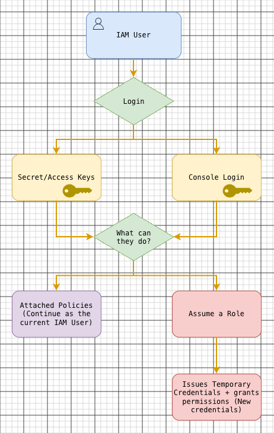
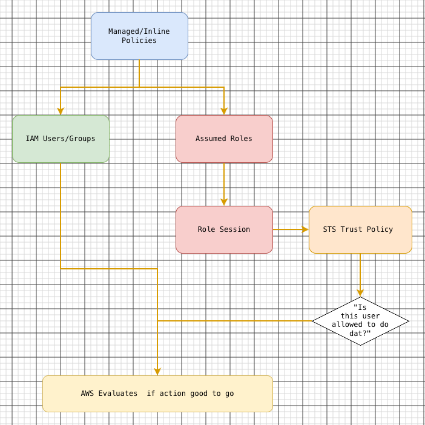

AWS Tips and Tricks to navigate/identify weaknesses within your AWS Cloud! 

## Configuring Credentials

Reccomend using your personal as the default and for any boxes/labs create a profile to correctly seperate permissions/roles across lateral movement.

```bash
aws configure --profile <profile>
```

Whoami
```bash
aws sts get-caller-identity
```

## IAM Overview
Identity is king, and knowing what has permissions where is very important. This section covers the different ways permissions are granted in AWS. 

1. Access/Secret Keys 
2. Attached Policies 
3. Roles



### Secret/Access Keys 
Access and Secret keys are long-term credentials typically used for programmatic access to resources on AWS. The reason why these would be used over other services is for long term access such as pulling data from an S3 bucket or constance access to lambda functions in order to test them. In other words developers typically use these for testing as well as ensuring integrations work correctly. 

You can set them in your AWS configuration file as shown below: 
```bash
[default]
aws_access_key_id = <access_key>
aws_secret_access_key = <secret_key>
```

### Roles & Policies

An IAM policy is a set of rules that allow or deny actions on AWS resources. After a user signs in to the console or authenticates a CLI or API request with an access key ID and secret access key, AWS evaluates the policies that apply to each request. [AWS policy evaluation logic](https://docs.aws.amazon.com/IAM/latest/UserGuide/reference_policies_evaluation-logic.html)

- **Managed policies** are reusable across users, groups, and roles.
- **Inline policies** belong to one user, group, or role.
- **IAM roles** have a trust policy that defines who can assume the role and permissions policies that define what the role can do.

[AWS managed and inline policies](https://docs.aws.amazon.com/IAM/latest/UserGuide/access_policies_managed-vs-inline.html) · [AWS IAM roles](https://docs.aws.amazon.com/IAM/latest/UserGuide/id_roles.html)



If your current identity has the corresponding IAM permissions, you can list managed policy attachments, inline policy names, and group memberships:

```bash
aws iam list-attached-user-policies --user-name Alice
aws iam list-user-policies --user-name Alice
aws iam list-groups-for-user --user-name Alice

aws iam list-attached-role-policies --role-name BucketLister
aws iam list-role-policies --role-name BucketLister
```

These lists help you find policies to review. Effective access also depends on the request context and any other applicable policies. [AWS ListAttachedUserPolicies API reference](https://docs.aws.amazon.com/IAM/latest/APIReference/API_ListAttachedUserPolicies.html)

#### Inline

Say we want an IAM user named `Alice` to list the objects in a general-purpose S3 bucket named `example-audit-bucket`. Listing shows object keys. Downloading an object requires the separate `s3:GetObject` permission. [Amazon S3 ListObjectsV2 reference](https://docs.aws.amazon.com/AmazonS3/latest/API/API_ListObjectsV2.html)

```json
{
  "Version": "2012-10-17",
  "Statement": [
    {
      "Effect": "Allow",
      "Action": "s3:ListBucket",
      "Resource": "arn:aws:s3:::example-audit-bucket"
    }
  ]
}
```

1. Alice authenticates as herself.
2. She requests the object listing for `example-audit-bucket`.
3. AWS evaluates the applicable policies. The inline policy allows the listing if no other applicable policy or guardrail blocks access.

#### Roles

Below is a role that Alice can assume.
```json
{
  "Version": "2012-10-17",
  "Statement": [
    {
      "Effect": "Allow",
      "Principal": {
        "AWS": "arn:aws:iam::123456789012:user/Alice"
      },
      "Action": "sts:AssumeRole"
    }
  ]
}
```

1. Alice authenticates as herself. The listing fails if her user has no other grant for `s3:ListBucket`.
2. She assumes `BucketLister`. AWS STS issues a temporary access key ID, secret access key, and session token.
3. She retries the listing as the role session. AWS evaluates the request using the role's permissions and any applicable limits.

Roles let teams delegate task-specific access to authorized users, workloads, and services. When reviewing an identity's access, check what it can do directly and which roles it can assume. A role with broader permissions than the task requires can give that identity more access than intended.

#### IAM changes to use/monitor 

Review these AWS CloudTrail events against approved changes. AWS’s guide to creating CloudWatch alarms includes an example for IAM policy changes. AWS also documents how IAM and STS activity appears in CloudTrail. [CloudWatch alarms for CloudTrail events](https://docs.aws.amazon.com/awscloudtrail/latest/userguide/cloudwatch-alarms-for-cloudtrail.html) · [Logging IAM and STS API calls with CloudTrail](https://docs.aws.amazon.com/IAM/latest/UserGuide/cloudtrail-integration.html)

| CloudTrail event | What to review |
| --- | --- |
| `AttachUserPolicy` | Whether the new managed policy grants more access than the user needs. |
| `UpdateLoginProfile` | Whether the user’s console password change matches an approved reset. |
| `CreateAccessKey` | Whether the key creation matches an approved rotation or onboarding request. |
| `PutRolePolicy` | Whether the new or updated inline policy gives the role broader permissions. |
| `AddUserToGroup` | Whether the new group membership grants access the user was approved to receive. |
| `UpdateAssumeRolePolicy` | Whether the trust change adds unexpected principals or relaxes conditions. |
| `CreatePolicyVersion` | What changed in the customer-managed policy and whether the new version became the default. |

For managed policy changes, check `SetDefaultPolicyVersion` as well. A new version can exist without being active. [AWS IAM policy versioning](https://docs.aws.amazon.com/IAM/latest/UserGuide/access_policies_managed-versioning.html)

### Enum 
Now the challenging part of getting a foothold in AWS is first finding out how to login, so this section will go over Enumeration, and the techniques surrounding it. The following is what you should aim to get when doing enumeration: 

1. AWS Account ID 
2. Possible Usernames/Credential pairings
3. Publicly Exposed Resources
4. Users/Roles that may be exposed.

#### AWS Account ID
Although it might not seem like it, having an AWS Account ID leaked can lead to many things going wrong for defenders. You can 
1. Login and brute force users 
2. Enumerate resources with that account ID 
3. Phish users knowing that account ID.

But how can you find it? There are numerous ways, for example: 
1. S3 Bucket belonging to a website that is part of the target account 
2. Leaked Access Key from github 

##### S3 Bucket Enumeration
Note: the role can be your own
```bash
s3-account-search <role> <bucket-name>
```
Please see: https://github.com/WeAreCloudar/s3-account-search 

##### Through an Access Key 
```bash
aws sts get-access-key-info --access-key-id="access key"
```

#### Identifying Public Resources
Just use: https://www.techwithtyler.dev/cloud-security/aws/aws-offensive-security/aws-attacks-and-techniques/enumerate-aws-public-resources 

## Related lab notes

- [Prowler and AWS Security Hub CSPM](/lab-notes/pwnlabs/prowler/)
- [Amazon Inspector](/lab-notes/pwnlabs/amazon-inspector/)
- [Multi-Juicer on a Home Lab Environment](/lab-notes/multi-juicer/)
