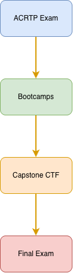
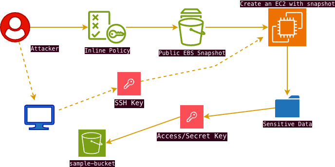
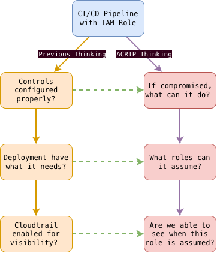

# What is ACRTP? 
ACRTP is Pwn Labs Amazon Cloud Red Teaming Professional cert that tests your ability to pentest an AWS Environment. This is useful for not only pentesters but, security engineers such as myself that work mostly in a cloud shop. 

# How long did it take to prepare? 
3 weeks after studying the content pretty consistenly and doing the labs at a CTF approach helped me be able to take the exam a lot earlier. If you are brand new to AWS and have not worked in the cloud though I would suggest a month or two to fully understand the content. 

# What does the bootcamp entail? 

Everything that is listed on the bootcamps, for this I will refer to the main site:  https://pwnedlabs.io/bootcamps/placrtp-bootcamp

The bootcamp itself you could put on x1.25 speed and just consume the content that way, the labs are where this course really shine. I would reccomend going through each of them on your own first then going through the walkthrough. This helps build your understanding on all the services and forces you to understand them at a different level. This is why the capstone CTF at the end of the course as well as the final exam came pretty easily to me as well as I felt very comfortable as they will not throw anything at you that is not totally in the bootcamp.

That being said, a lot of the exploits/lateral movement comes down to Identity utilization in AWS. The exploits themselves for each of the AWS services are pretty straight forward, as the bootcamps sort of tell you how to exploit these services and the commands to break into them don't change as much. With the identity portion it is up to you on how to use that information to move and break into the environment. 

# How to prepare?
1. Recorded Lectures: Listening to the bootcamps is really good, just fully pay attention and write down anything you don't know. Don't copy word for word, if you can listen to a portion and try to recall what was said and why. For example, if writing about IMDS, what is the difference between v1 and v2? Why is v1 bad? How to exploit it? If you can recall from memory without blindly writing it down, you will retain things a lot better. These lectures are very high quality and taught from people in the industry and explain things perfectly. It is on you to do your own research and follow the information given to you fully.
2. Labs: With access to their bootcamps you actually get access to all their labs on Pwned Labs. Even for labs that are not designed to be CTF, I would reccomend trying to do it yourself with the initial scenario information and tackle the lab that way. Spend around 2-3 hours trying and if you can't make any progress reference the lab guide (obv this depends on your schedule) but, I find this very useful/beneficial for fully understanding services. By putting your back against the wall you force yourself to understand what you are doing, similar to hack the box versus THM.
3. Diagrams: For EVERYTHING you do, just make a diagram to visualize it, for example services between each of them and any concept you may not fully understand.
4. Commands: Writing commands into an excel with a short description was very useful for referencing them back. Also indexing/organizing them beforehand is a good review point.

Ex: https://app.pwnedlabs.io/labs/loot-public-ebs-snapshots -> This is a free lab that you can use as reference. 

I feel like knowing the technical concepts is one thing but applying them together and doing what the initial cert description says which is "chaining" is another thing. Sitting down and fully understanding how these services connect and why is important. There were times I did get stuck but, that is also where I grew the most.

# Is it worth it? 

Being on the Security Engineering side and building tools on AWS, I would say it is worth it. I am able to explain AWS services at a different level BECAUSE I know how they can be abused now. There are genuine levels to it, and while building is a good foundation, knowing the attacker's perspective is really good to know especially for if you want to improve security.

