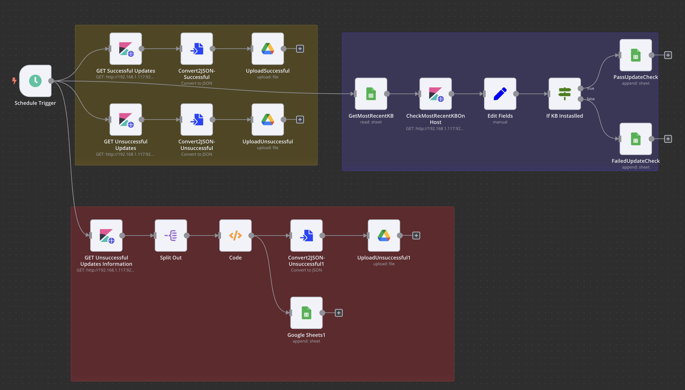
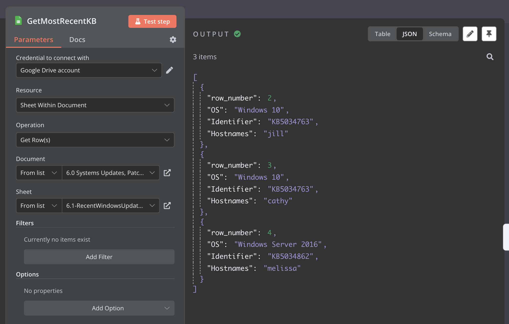
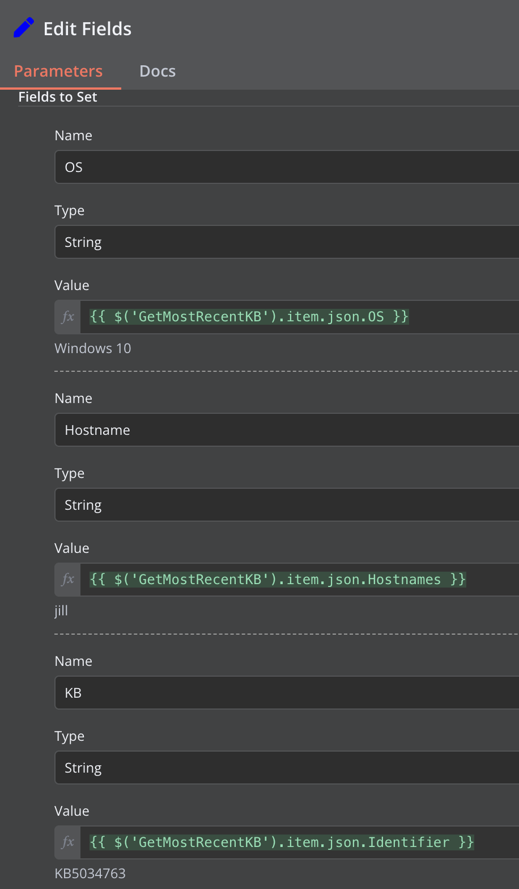
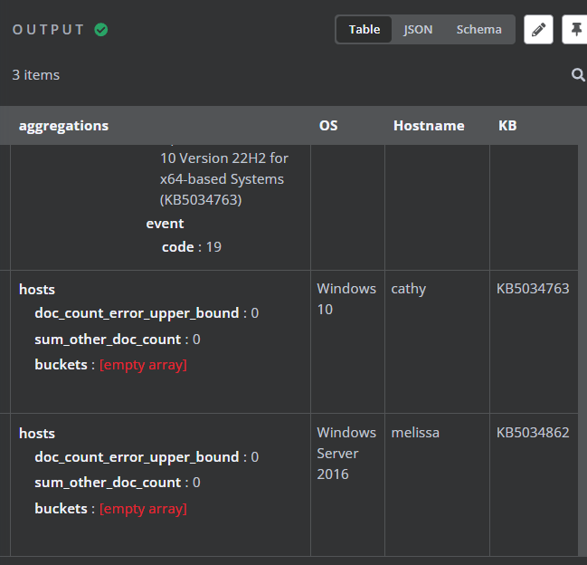
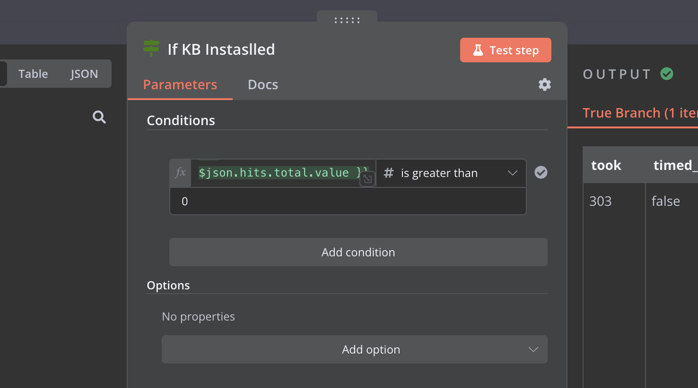
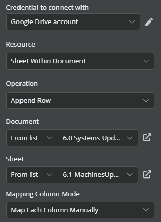
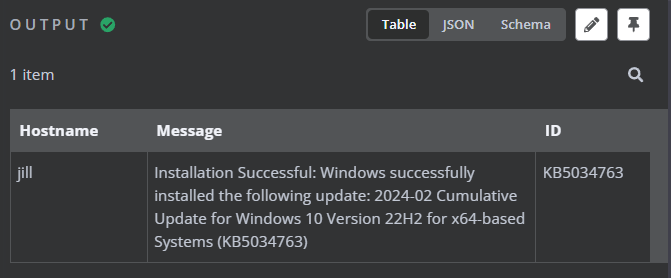
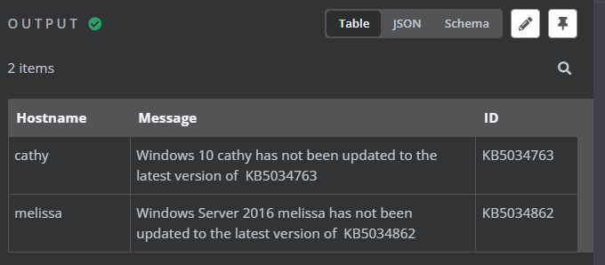

Requirement 6.1 is essentially just checking if systems are up to date. This can be done with a relatively simple workflow, that pulls information about the latest update and compares it to the devices that are needed to it.



This is the expanded version of the workflow that we had earlier, just with the added functionality of determining whether or not a system is updated to the most recent version, which is in the blue block. These are the steps from a very High Level, starting with the `GetMostRecentKB` node.

1. We get information from the GetMostRecentKB that holds data about the most recent updates our Windows hosts should have:
    
    
    
    As you see from the screenshot, we get data formatted in json of the different hosts that we have on the network and what they should be updated to. Note, I had to make the sheet manually, so every month someone would have to update the sheet manually, and I’m still working on a script that will scrape a website and then upload the most recent update based on the host information. For now I just have it set to these values. You could possible run an SSH node and check maybe? If you figure it out please tell me lol.
    
2. Then we iterate over these json values, if you notice from the output in the screenshot in step one, there are `3 items` which means we are sending essentially 3 inputs into the next node which is the Kibana one. This Kibana node is like the one in the example workflow but, instead of doing 1 query we are doing 3 since the input is three from the Google Sheet node. This is what the json looks like when we send the body over:
    
    ```json
    {
      "size": 0,
      "query": {
        "bool": {
          "must": [
            {
              "match": {
                "message": "{{ $input.item.json.Identifier }}"
              }
            },
            {
              "term": {
                "event.code": "19"
              }
            },
            {
              "match": {
                "host.name": "{{ $input.item.json.Hostnames }}"
              }
            }
          ]
        }
      },
      "aggs": {
        "hosts": {
          "terms": {
            "field": "host.name",
            "size": 10
          },
          "aggs": {
            "failed_updates_details": {
              "top_hits": {
                "size": 5,
                "_source": {
                  "includes": [
                    "message",
                    "event.code",
                    "event.time"
                  ]
                }
              }
            }
          }
        }
      }
    }
    
    ```
    
    Most of this is the same as the example workflow but, take note of the `{{}}` items, this is where we define data about the input that we want to include, such as which host name do we want to look for as well as the update code. Then from the output we see:
    
    ```json
    [
      {
        "took": 416,
        "timed_out": false,
        "_shards": {
          "total": 1,
          "successful": 1,
          "skipped": 0,
          "failed": 0
        },
        "hits": {
          "total": {
            "value": 1,
            "relation": "eq"
          },
          "max_score": null,
          "hits": []
        },
        "aggregations": {
          "hosts": {
            "doc_count_error_upper_bound": 0,
            "sum_other_doc_count": 0,
            "**buckets**": [
              {
                "key": "jill",
                "doc_count": 1,
                "failed_updates_details": {
                  "hits": {
                    "total": {
                      "value": 1,
                      "relation": "eq"
                    },
                    "max_score": 13.645115,
                    "hits": [
                      {
                        "_index": ".ds-winlogbeat-8.12.1-2024.02.07-000001",
                        "_type": "_doc",
                        "_id": "JF38so0B59iVSj99vNkl",
                        "_score": 13.645115,
                        "_source": {
                          "message": "Installation Successful: Windows successfully installed the following update: 2024-02 Cumulative Update for Windows 10 Version 22H2 for x64-based Systems (KB5034763)",
                          "event": {
                            "code": "19"
                          }
                        }
                      }
                    ]
                  }
                }
              }
            ]
          }
        }
      },
      {
        "took": 602,
        "timed_out": false,
        "_shards": {
          "total": 1,
          "successful": 1,
          "skipped": 0,
          "failed": 0
        },
        "hits": {
          "total": {
            "value": 0,
            "relation": "eq"
          },
          "max_score": null,
          "hits": []
        },
        "aggregations": {
          "hosts": {
            "doc_count_error_upper_bound": 0,
            "sum_other_doc_count": 0,
            "buckets": []
          }
        }
      },
      {
        "took": 85,
        "timed_out": false,
        "_shards": {
          "total": 1,
          "successful": 1,
          "skipped": 0,
          "failed": 0
        },
        "hits": {
          "total": {
            "value": 0,
            "relation": "eq"
          },
          "max_score": null,
          "hits": []
        },
        "aggregations": {
          "hosts": {
            "doc_count_error_upper_bound": 0,
            "sum_other_doc_count": 0,
            "buckets": []
          }
        }
      }
    ]
    
    ```
    
    Three different items as well, each corresponding to the hosts that we saw in step one. Now that we got who has been updated or not, how do we determine if it’s the latest? As you might notice there is a bucket item in there that returns the actual logs that were returned from the query. If it was empty that means no matches were found.
    
3. Now how do we know which json host belongs to which host? Each query is run in sequentially, so that means after one input item has been processed, the next one is processed, so it is not in parallel. Meaning we could get the host information and the identifier from the previous node since the inputs should match the order in which we did the query, note these are the fields that I have edited, n8n is nice in that you can drag and drop the items that you want to pull. Again this is so we can access this information later and determine which hosts are updated correctly or not:
    1. `OS:{{ $('GetMostRecentKB').item.json.OS }}`
    2. `Hostname:{{ $('GetMostRecentKB').item.json.Hostnames }}`
    3. `KB:{{ $('GetMostRecentKB').item.json.Identifier }}`
    
    
    
    
    
4. Now the next step is to use the if gate to determine whether or not an udpate was successful or not. We can do this again, by looking at the amounts of hits the query got us. If there are no queries, it means that the host has not been updated to the most recent version since we searched for the specific KB value:
    
    
    
5. Then we upload to the appropriate google sheets with the appropriate message, as you can see we use the fields that we added on in step 3, in order to get more information onto there. Then for the fields that we added under `Map Each Column Manually`
    1. `{{ $json.aggregations.hosts.buckets[0].key }}`
    2. `{{$json.aggregations.hosts.buckets[0].failed_updates_details.hits.hits[0]._source.message }}`
    3. `{{ $json.KB }}`
    
    
    
    
    
    
