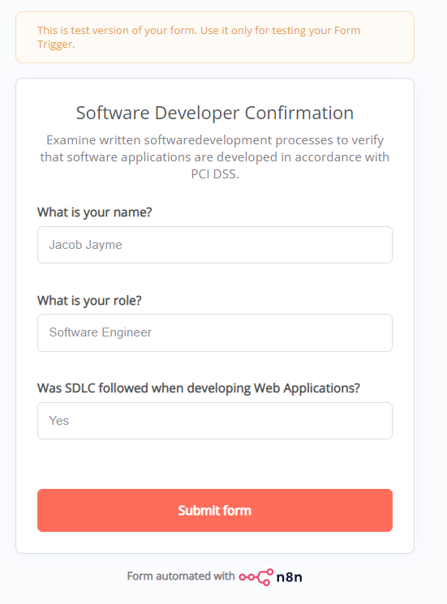

6.3 is interesting in that it delves into the Software Development Life Cycle for developing Secure web applications. Now I won’t go too much into depth about this but, it is important to know the key concepts of the workflow as well. 

6.3 Describes the following on the Audit Template:

> Develop internal and external software applications (including web-based administrative access to applications) securely, as follows:
• In accordance with PCI DSS (for example, secure authentication and logging).
• Based on industry standards and/or best practices.
• Incorporate information security throughout the software development life cycle
> 

Specifically we will be looking at `6.3.d`, where it states: `Interview software developers to verify that written software development processes are implemented.` This is just an example of how we can use n8n to send forms to the specified people on a trigger. 

