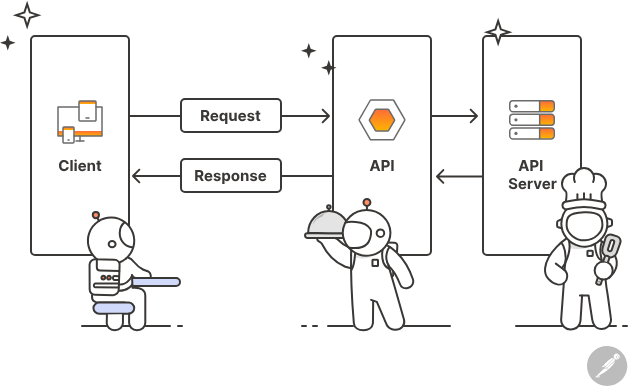

Application Programming Interfaces (or APIs) are essential in order for two seperate machines to be able to talk to each other. This can be cloud applications talking to a server, or applications interacting with an operating system but, APIs are a way to transfer and submit data between different devices. In summary, APIs are a set of rules that define how computers, applications, or machines should talk to each other. For example User Interfaces are used by a human being, while APIs are intended for use by an application or computer. 



The above picture is from postman, and breaks down what an API does at a very high level. As you can see the client communicates with the API and it is sort of like a client-server model where you request something and it responds with something as well. Where the customer is making the order, then the API delivers the order to the API server, and the server creates the appropriate response. From there the Server or the API provides a response to the client. 

From here we can try to do something similar with python: 

```python
import requests

def get_weather(city_name):
    api_key = 'YOUR_API_KEY'
    base_url = "http://api.openweathermap.org/data/2.5/weather?"
    complete_url = f"{base_url}appid={api_key}&q={city_name}&units=metric"
    
    response = requests.get(complete_url)
    if response.status_code == 200:
        data = response.json()
        main = data['main']
        temperature = main['temp']
        humidity = main['humidity']
        weather_description = data['weather'][0]['description']
        
        print(f"Weather in {city_name}:")
        print(f"Temperature: {temperature}°C")
        print(f"Humidity: {humidity}%")
        print(f"Description: {weather_description.capitalize()}")
    else:
        print("Error in the HTTP request")

city_name = input("Enter city name: ")
get_weather(city_name)

```

As you can see from the example we are able to interact with the weather API and return an output in context of the results. You’ll see with Nessus and Kibana later in the blogs but, we are able to parse it by converting it to json and treating it like a dictionary. A dictionary is essentially just key pair values. 

## Resources:

[https://tray.io/blog/how-do-apis-work](https://tray.io/blog/how-do-apis-work)
