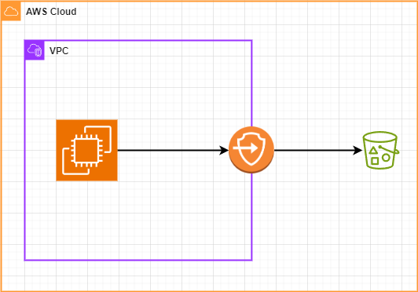

In this section of my lab, I decided to *attempt* to replicate [this](/lab-notes/evidence-automation/automating-compliance-in-aws-w-terraform/) video example that was show before from Hashicorp. It goes into how we can use Terraform modules to automate some of the FedRAMP security controls across AWS resources. For this one I will be doing this example that was given: 

As you can see we have 3 main things, and the given: 

- **EC2**
    - Security Groups for external information services (SA), boundary protection (SC-7), encryption for system and communications protection (SC-13)
- **VPC Endpoint**
    - VPC Endpoints for boundary protection (SC-7), ACLs for external information services (SA-9)
- **S3 bucket**
    - Access Control (AC) achieved via S3 bucket policy, Versioning & lifecycle for system integrity (SI), replication & logging for audit (AU), and encryption for system and communications protection (SC-13)
