Nessus is a very important tool especially for audits, in that it allows us to scan the environment periodically and understand the environment from a glance. While Nessus has a nice interface to interact with, it is important to understand that we can pull out more relevant information that might be needed for an audit and realate it to other information as well. 

If you haven’t already, I have a Nessus setup guide in the beggining of this Lab setup but, in order to access information about the API you can look at the /api url of the website. With this you can see the endpoint is `https://<ip-address>:8834/api/` 

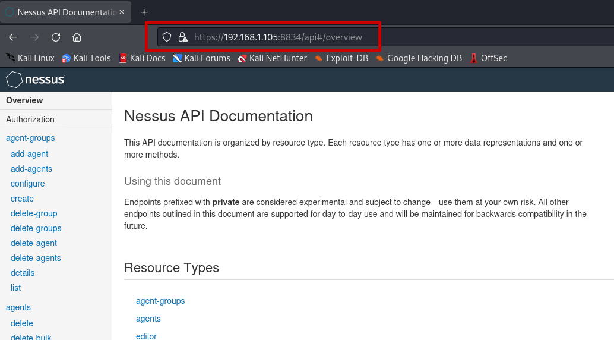

From there look at the overview and look for these items on the left hand side of the API Documentation: 

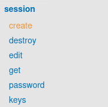

Then go to test to receive the token. 

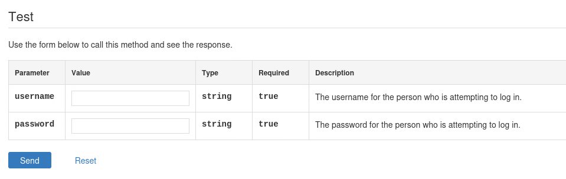

Then input the service account (do not use a personal or main account, make an account that does ONLY thing that you want to do). Then you can press `Send` and then see the responses. 

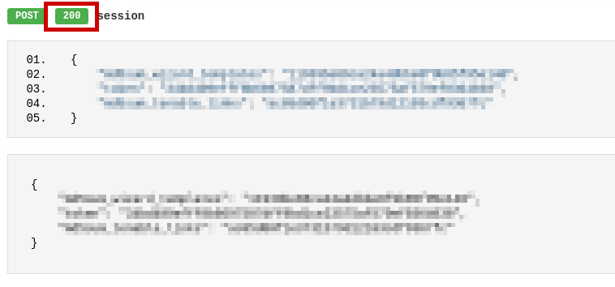

From there you can see the token and then create the session for the nessus scanner. An alternative to this is using the API keys as well, it is important to make sure these are stored securely to make sure no one gets access to them. 

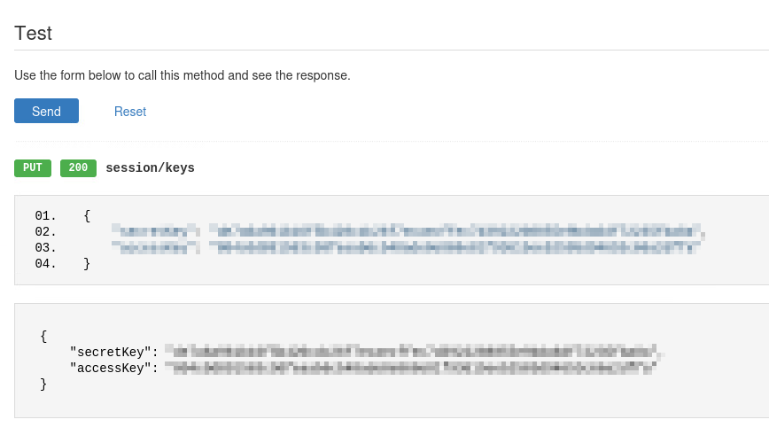

As you can see we have both an access key and a secret key. These are different ways to authenticate with Nessus but, I will be creating a service account and getting a key for that service account everytime I want to access any type of information on there. 

Now we get to the intersting part, which is understanding how to interact with this API. There are two main things that you must understand in order to be able to interact effectively with Nessus’s API as well as parse the relevant information that you may want:  1. How APIs work 2. How Python works (and also json data structures). If you need some help understanding these topics please refer to [this](/lab-notes/evidence-automation/apis/) page at the beggining of the blog. 

Alright cool, now to actually interacting with the API with some python code. So to start off I will show how to list the scans on your nessus instance utilizing python. In order to do this make sure you have python installed and be able to sign in to your nessus instance. You can actually see some sample python code for interacting with the Nessus instance [here](https://developer.tenable.com/reference) if you want to explore the different options. 

Here is the full code for authenticating with Nessus as well as getting scan information. This is purely just getting scan information but, later we will be using python to pull out the relevant information about it and attempt to tell a story. 

```python
import requests
import json
import time
import os
from dotenv import load_dotenv

# Loading up environment variables, you will have to do this yourself.
load_dotenv()
IP_ENDPOINT = os.getenv("IP_ENDPOINT")
NESSUS_USERNAME = os.getenv("NESSUS_USERNAME")
NESSUS_PASSWORD = os.getenv("NESSUS_PASSWORD")

# Disable warnings for SSL Certificate for testing purposes only
requests.packages.urllib3.disable_warnings()
print(IP_ENDPOINT)
# First request to get the token
url = f"https://{IP_ENDPOINT}/session"
data = {"username": NESSUS_USERNAME, "password": NESSUS_PASSWORD}

# Note: verify=False is used to bypass SSL verification. This is not recommended for production code.
response = requests.post(url, json=data, verify=False)
token = response.json()["token"]
print(token)

time.sleep(3)

# Second request to get the scans using the token for authentication.
url = f"https://{IP_ENDPOINT}/scans"

# Add the token to the request headers for authentication, this is the token we got earlier. This is us interacting with the session we created earlier.
headers = {
    "X-Cookie": f"token={token}"
}

# Note: There's no data to send with GET, so we remove the data parameter
response = requests.get(url, headers=headers, verify=False)

# Check if the response was successful
if response.status_code == 200:
    print(response.json())
else:
    print(f"Failed to get scans. Status code: {response.status_code}, Message: {response.text}")
```

As you can see from the output of the script we get something like this: 

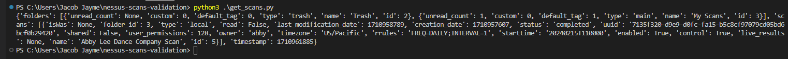

We can see the scans that are being used in Nessus as well as the frequency, if it was completed, if it’s enabled, and the IDs of them as well. This gives us a lot of great data but, how can we parse it to only get what we want from it? 

Here is the output in text just so I can show what kind of relevant information we may want for an audit: 

```json
{
  "folders": [
    {
      "unread_count": null,
      "custom": 0,
      "default_tag": 0,
      "type": "trash",
      "name": "Trash",
      "id": 2
    },
    {
      "unread_count": 1,
      "custom": 0,
      "default_tag": 1,
      "type": "main",
      "name": "My Scans",
      "id": 3
    }
  ],
  "scans": [
    {
      "isWas": null,
      "folder_id": 3,
      "type": "local",
      "read": false,
      **"last_modification_date": 1710958789**,
      **"creation_date": 1710957607**,
      **"status": "completed"**,
      "uuid": "7135f320-d9e9-d0fc-fa15-b5c8cf97079cd05bd6bcf0b29420",
      "shared": false,
      "user_permissions": 128,
      **"owner": "abby"**,
      "timezone": "US/Pacific",
      **"rrules": "FREQ=DAILY;INTERVAL=1",**
      "starttime": "20240215T110000",
      "enabled": True,
      "control": True,
      "live_results": null,
      **"name": "Abby Lee Dance Company Scan"**,
      "id": 5
    }
  ],
  "timestamp": 1710981912
}

```

Here are some items that might be of importance: 

- `"last_modification_date:"` : Last modification date of the scan
- `"creation_date:"` Creation date of the scan
- `"status:"` Status of the scan, if it ran into any problems
- `"owner:"` Owner of the scan
- `rrules:` Frequency of the scan
- `"name"` name of the scan

Now how do we parse this information in a way that’s understandable? We can use f-string and parse the json: 

```json
import requests
import json
import time
import os
from dotenv import load_dotenv
from datetime import datetime

# Loading up environment variables, you will have to do this yourself.
load_dotenv()
IP_ENDPOINT = os.getenv("IP_ENDPOINT")
NESSUS_USERNAME = os.getenv("NESSUS_USERNAME")
NESSUS_PASSWORD = os.getenv("NESSUS_PASSWORD")

# Disable warnings for SSL Certificate for testing purposes only
requests.packages.urllib3.disable_warnings()
# print(IP_ENDPOINT)
# First request to get the token
url = f"https://{IP_ENDPOINT}/session"
data = {"username": NESSUS_USERNAME, "password": NESSUS_PASSWORD}

# Note: verify=False is used to bypass SSL verification. This is not recommended for production code.
response = requests.post(url, json=data, verify=False)
token = response.json()["token"]
# print(token)

time.sleep(3)

# Second request to get the scans using the token for authentication.
url = f"https://{IP_ENDPOINT}/scans/"

# Add the token to the request headers for authentication, this is the token we got earlier. This is us interacting with the session we created earlier.
headers = {
    "X-Cookie": f"token={token}"
}

# Note: There's no data to send with GET, so we remove the data parameter
response = requests.get(url, headers=headers, verify=False)

# Check if the response was successful
if response.status_code == 200:
    
    **# Pull out the necessary information
    scans = response.json()["scans"][0]
    last_modification_date = scans["last_modification_date"]
    creation_date = scans["creation_date"]
    status = scans["status"]
    owner = scans["owner"]
    rrules = scans["rrules"]
    name = scans["name"]

    parsed_output = f"""
        This is the last modification date: {last_modification_date}
        This is the creation date: {creation_date}
        This is the status of the scan: {status}
        This is the owner of the scan: {owner}
        This is the rules for the scan: {rrules}
        This is the name of the scan: {name}
    """**
    
    print(parsed_output)

else:
    print(f"Failed to get scans. Status code: {response.status_code}, Message: {response.text}")
```

In the response you can see the scan information from there and the details around it. Now, this is great and all but, how do we get this to upload to things like google drive or maybe an S3 bucket so we can centralize it? For this I like to use workflows. If you haven’t read my n8n blog please make sure to find it in the previous blogs but it is able to connect multiple applications very easily. 

Here we have a simple workflow essentially doing the same thing: 

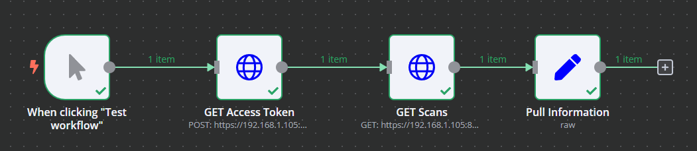

Again if you haven’t read my **n8n documentation** as well, please go ahead and try to set it up yourself and play around with it. It’s great because of its ability to do cross application stuff. As you can see there are 4 nodes (the squares) on the workflow as of right now. This is the output of the workflow: 

Essentially the same thing as the python script but made a lot easier so lets break it down. 

1. **Trigger:** Click is the trigger, we can change this to be on a scheduled task later. 
2. **GET Access Token:** Authenticating with Nessus, creating a user session

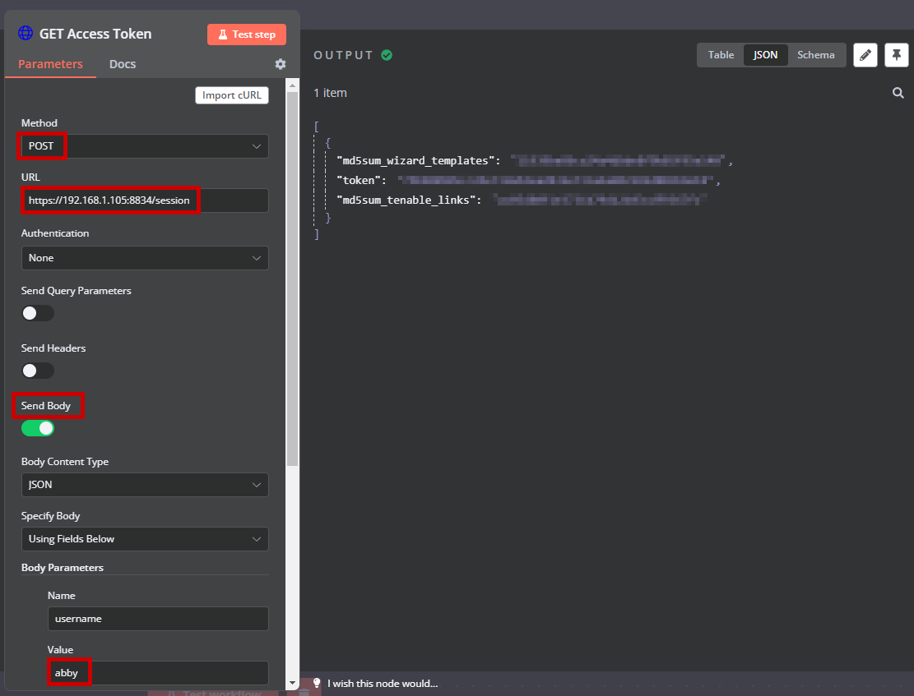

1. **Get SCANS:** Once you have the session go and get the scan information and check if they are being run Frequently 

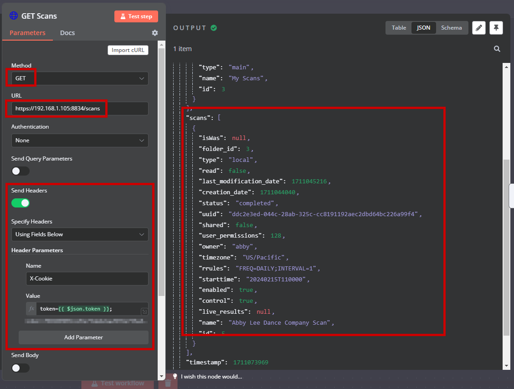

1. **Pull Information:** Pull out the relevant information we have from the scan that we may need for an audit 

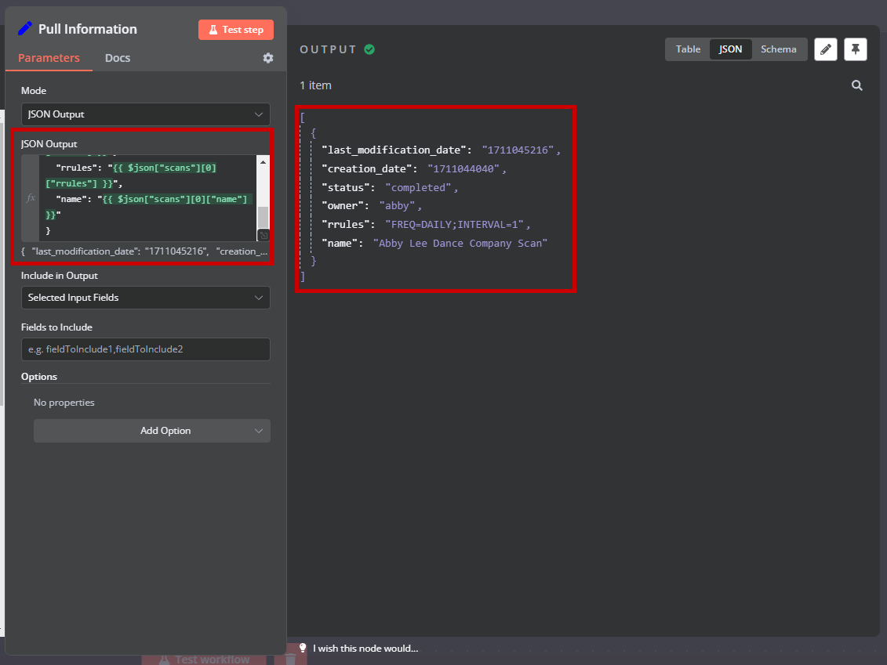

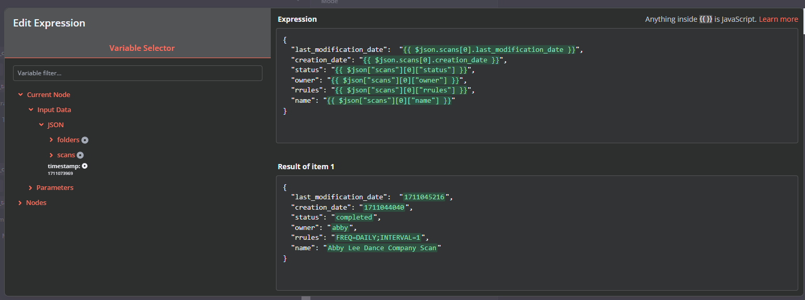
