## Example Workflow for Kibana Logs

Just to get our feet wet, here is the foundational workflow we will basically be using for these requirements. 

### Ingesting Data

1. Login to you’re n8n instance and select `Add workflow`
    
    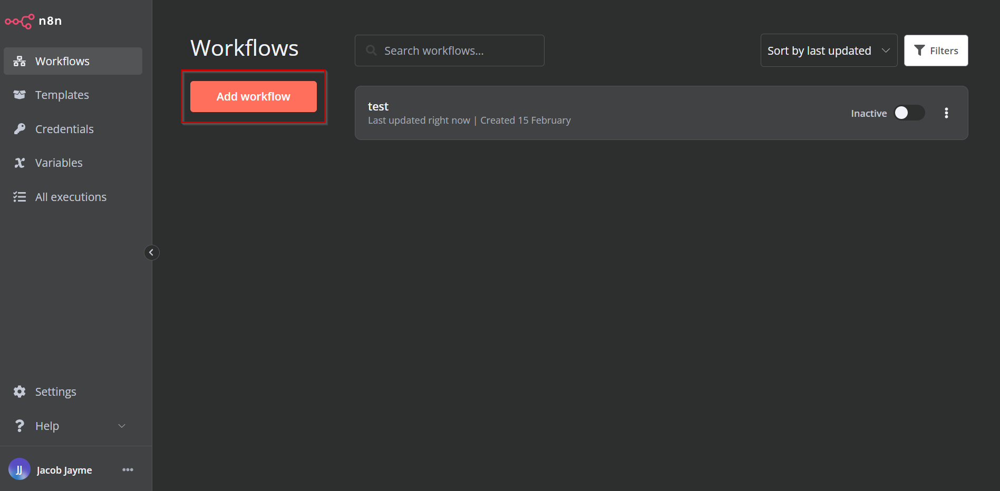
    
2. From there I rename it to the requirement that I will be creating the workflow for, in this case Requirement 6.0: 
    
    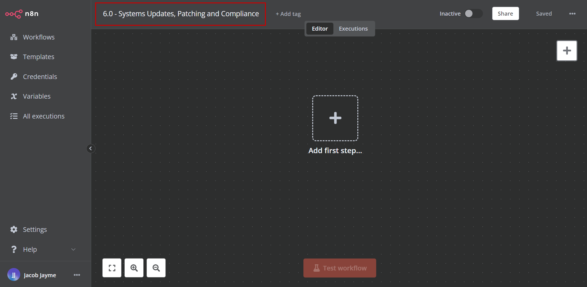
    
3. Now time to get to the fun stuff. Click on Add first step or the `+` button on the right hand side of the GUI: 
    
    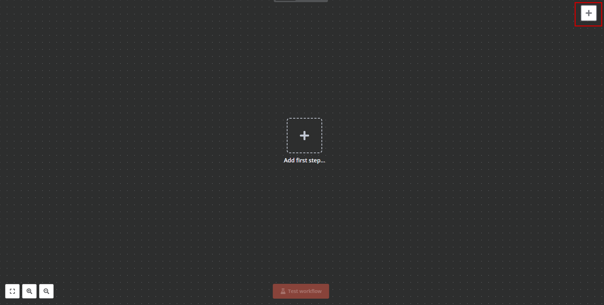
    
4. This opens the trigger for which we want our workflow to run on. In this case we see that we can run it on a schedule, so click `On a schedule`: 
    
    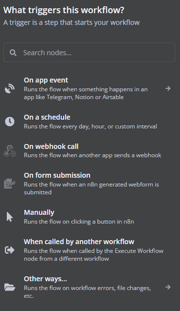
    
5. Then we can configure it to our likings, for me I will have it run weekly every Sunday at 7am: 
    
    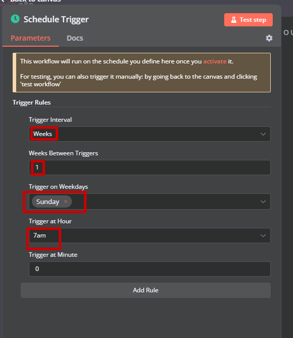
    
6. Then if we Test Step, we can see if it runs correctly and if it is valid: 
    
    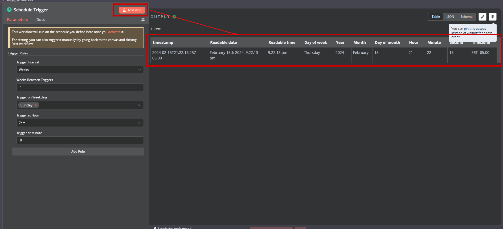
    
7. Now time to actually connect our data source which will be Kibana. Again, if you are unfamiliar or are wondering how I created the data for this I would recommend looking at my PCI Home lab to see more about how the logs were forwarded and such. So now add Kibana to your workflow: 
    
    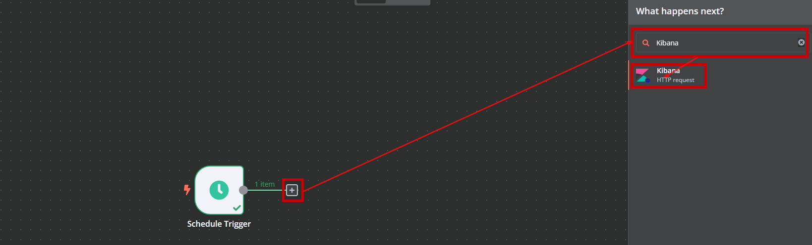
    
8. Now we will configure it so that we can actually authenticate and use Kibana’s API to pull logs from it. 
    1. First we set the method to `GET` because, we are getting the data from Kibana and then we’re going to do something with it later. 
    2. Then we enter int he url which in this case is [`http://192.168.1.117:9200/winlogbeat-*/_search`](http://192.168.1.117:9200/winlogbeat-*/_search) which is the most default url for the Kibana API. It can be broken down like this `http://<ip of your kibana server>:9200/<dataset you want to search>/_search` where the `<>` are where you put your own information. 
    3. Then you enter in your credentials for your Kibana instance.
    4. Then we send as body, this is how we will filter out the logs. The body I used was essentially looking for successful updates.
        
        ```nasm
        {
          "query": {
            "bool": {
              "filter": [
                {
                  "term": {
                    "event.code": 19
                  }
                }
              ]
            }
          }
        }
        ```
        
        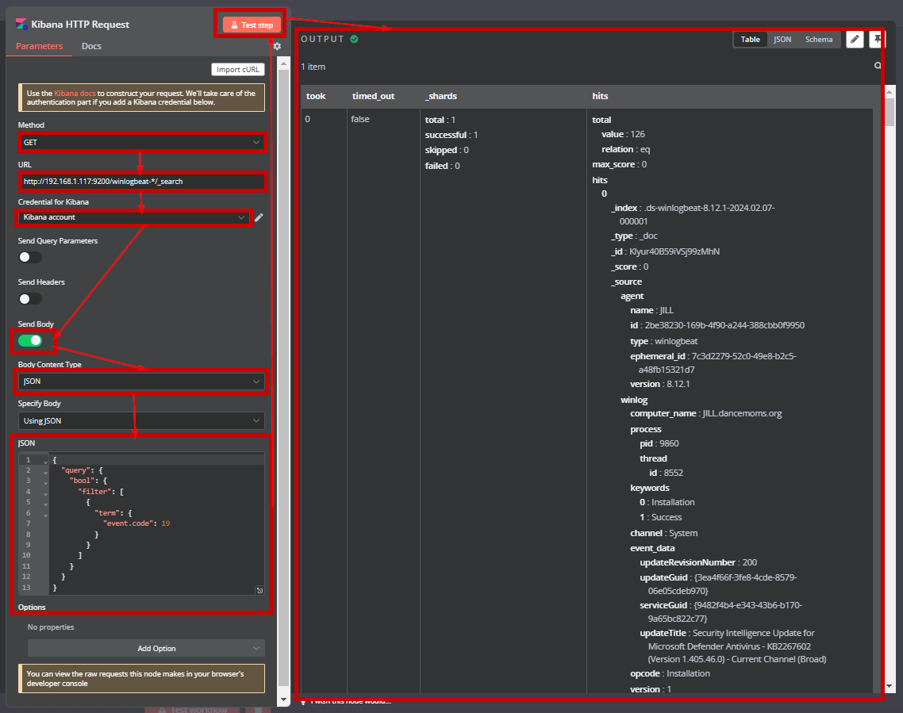
        

There you go! Now you are able to get data from Kibana, you can play around with the different queries you can have but, that is essentially how you would ingest data and use it to. 

### Uploading Data

Now that we have the data, where do we store it? The big thing about even accessing this kind of data, is how do we communicate it effectively? And in order to communicate it effectively, we have to centralize this data so that it is accessible. In this case I will be showcasing how to setup Google Drive to upload files on to there. 

1. First lets add a google drive node to the workflow. In this case we want the action to be upload a file: 
    
    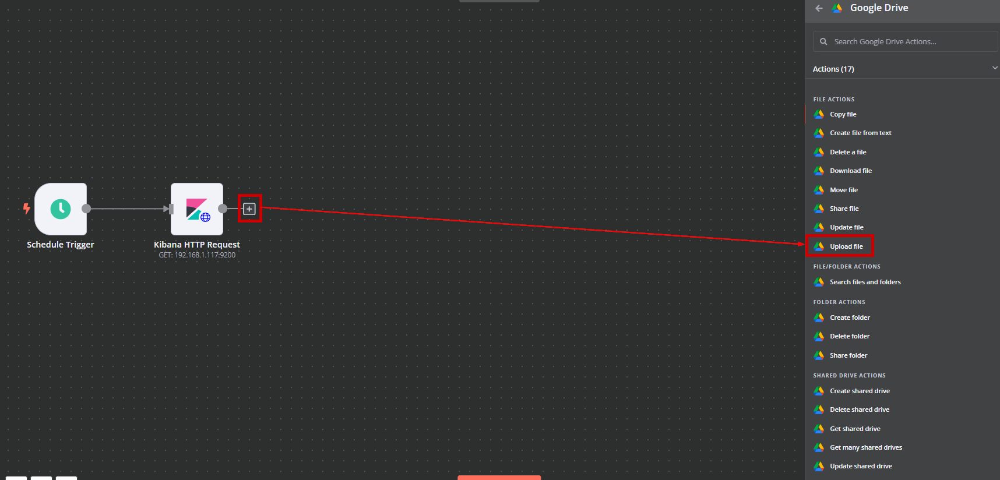
    
2. As you may notice there are a lot of parameters in order to get access to a google drive, in this case I will be going with the Service account option. So click on create new credentials → Create new service account:
    
    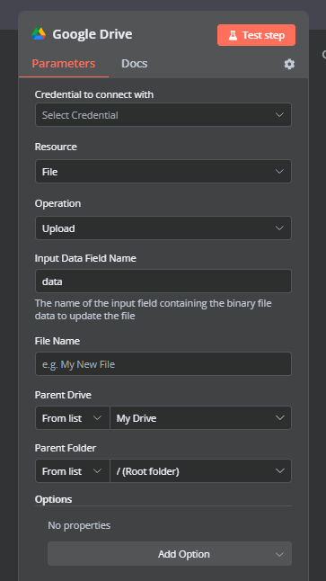
    
    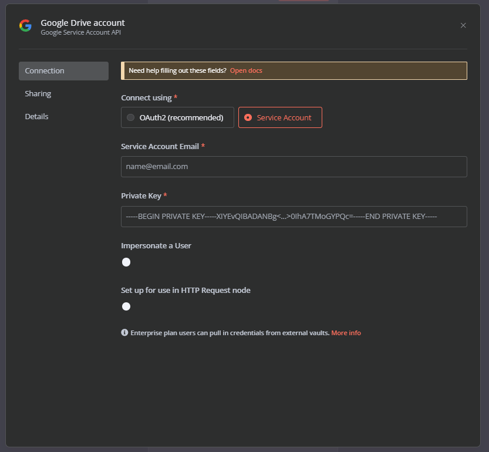
    
3. Now we will have to actually create the account, so we can use the `Open docs` option to see more information on how to do that. And then we go to the [google cloud console](https://console.cloud.google.com/) to start making our account. Then from there just follow the guide to make your service account. 
    
    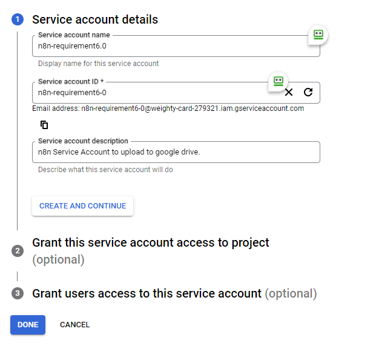
    
4. Then we can connect the account, and if you did it correctly you should see Connection tested successfully: 
    
    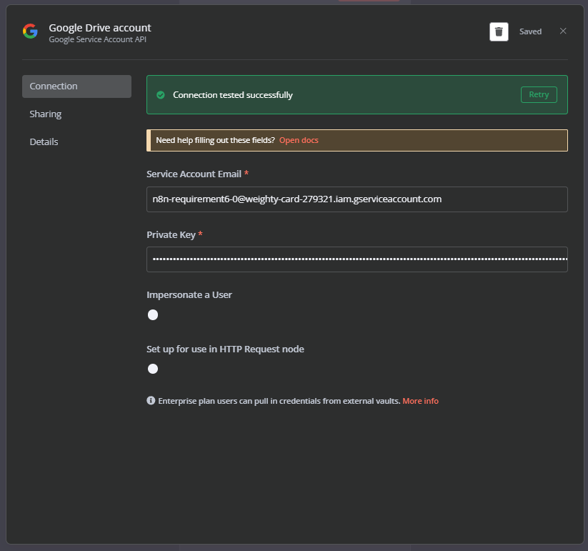
    
5. From there we have to decide where we want to upload these files to, in this case make a folder for your PCI requirements you want it to go to and **Create the Folder → Share it to the Service Account → Then start configuring the step!** 
    
    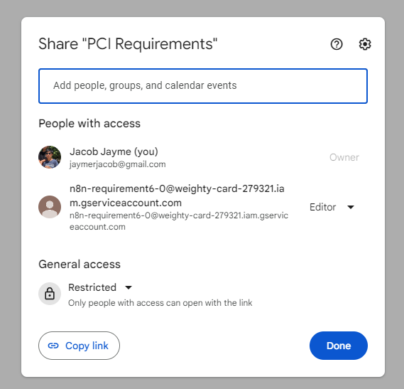
    
    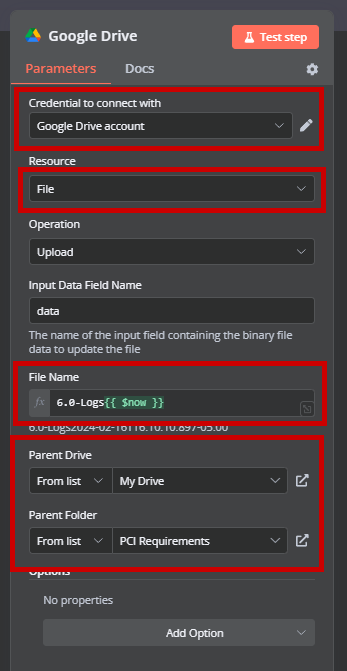
    
6. Then make sure it is converted to binary as well before you send it over. This is what the final workflow looks like: 
    
    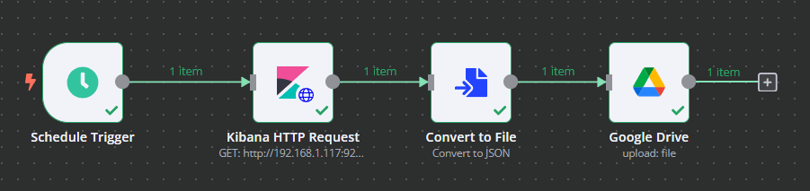
    
    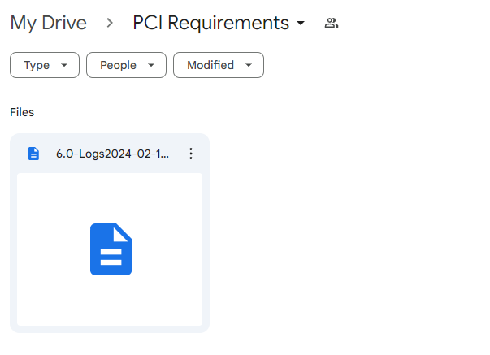
    

Pretty epic right? Now the only step to do is to also format the data so that it is readable. If you notice on the json file that is uploaded to google drive it is a whole lot of GIBBERISH. This is great for just having the evidence there and proving that you have continuous monitoring but, how do you use that data to efficiently communicate risk and remediate? This is where more of the programming comes in. Thanks to it being json we can iterate through the data and see if there is anything suspicious. 

### Understanding the Data

Now to actually give the data meaning. What does it actually mean? And how can we effectively use it? As you may have noticed, we only have successful updates here but, part of the audit is also knowing where failed updates had occurred and such. In this scenario I will be putting the unsuccessful updates in a google sheets so that we can understand the state that this requirement is in, and also catch any updates that failed. This is the end result of the final 6.0 workflow: 

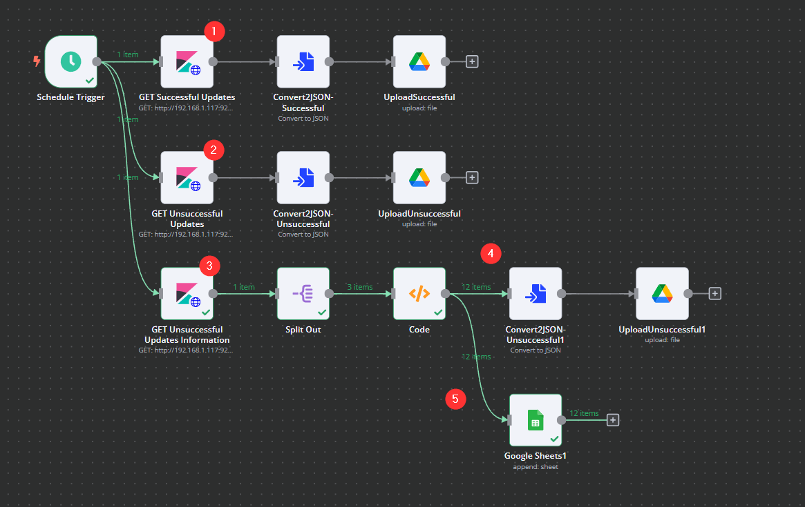

As you can see from the screenshot we have expanded to many different workflows, mainly to start creating workflows to backup our logs as well as pull the necessary information needed for audits from kibana into google drive where our compliance team can see and pull out any necessary information/prioritize on any holes that we may have. This is what the sheets looks like: 

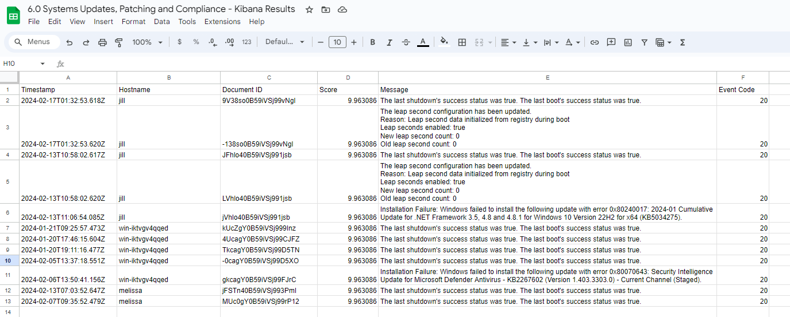

Now to get into the actual setup. 

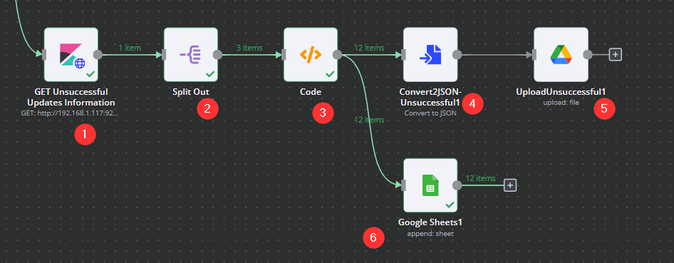

1. Another GET request to the Kibana server, instead this time we are also requesting additional information, again to the `/winlogbeat-*/_search` endpoint: 

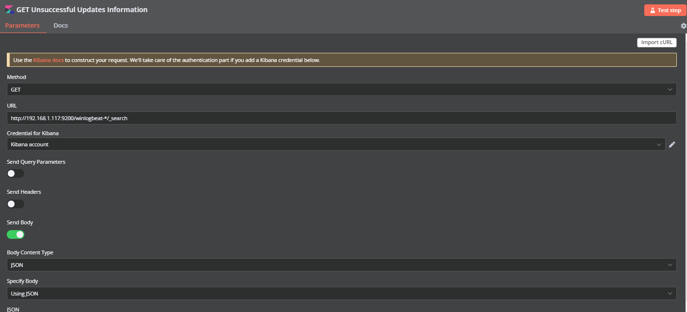

```json
{
  "size": 0,
  "query": {
    "term": {
      "event.code": "20"
    }
  },
  "aggs": {
    "hosts": {
      "terms": {
        "field": "host.name",
        "size": 10
      },
      "aggs": {
        "failed_updates_details": {
          "top_hits": {
            "size": 5,
            "_source": {
              "includes": [
                "message",
                "event.code",
                "@timestamp"
              ]
            }
          }
        }
      }
    }
  }
}
```

This response should look like something similar to this: 

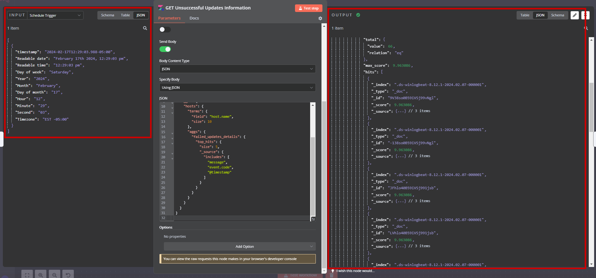

As you can see we get a response from Kibana with the information we described in the body. And this is triggered from the weekly node trigger we created in the beginning. 

1. Split out is not just refining that data, because there is some unnecessary stuff we don’t really need for an audit. We can actually pull one part of the JSON. I’m like 99% sure you can do this with the Kibana API LOLL, but I just wanted to experiment with some of the nodes here on n8n.

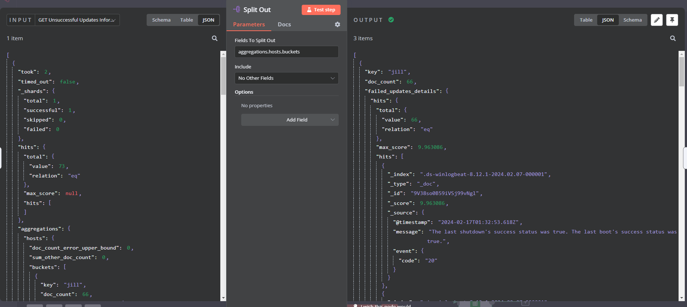

As you can see, we pull out the `aggregations.hosts.buckets` section of the json response from the previous node, and we take that as the input for the split out, which just formats all the different hosts and their associated logs. 

1. Now we get to the fun part, which is the Python Code!! Python is my comfort language but, you can also do this with JavaScript. I just like how readable python is and the different things it can provide in comparison to JavaScript. Step 3 essentially just converts the json into only the relevant information we want. Note there are some really important variables that are REALLY important. 
    1. **`_input` →** The Input from the previous node. In this case it was from the split that cut down the json data even more. 
    2. **`_input.all()` →** Gets all the input information, in this case we had three objects that we can iterate over it. 
    3. **`for item in _input.all():` →** Here we see that we’re iterating over all the inputs that we have. If you notice from the screenshot we have **3** items which are basically representing the 3 hosts that we have on the network (Jill, Melissa, etc). So each item is essentially their host and their corresponding logs.
    4. **`for hit in item.json.failed_updates_details.hits.hits:`** → This is where we iterate over the logs as well. Note that this nested in the previous for loop, so we are basically getting the logs for each host that has failed updates. Note that we are calling the `item` variable, and calling on its json objects to get the different logs. 
    5. The code block for row, are just the information that we want to gather, so this is where we really start making our CSV. 
        1. `"Timestamp": hit["_source"]["@timestamp"]` → Get’s the timestamp based on the JSON data

JSON Data: 

```json
[
{
"Timestamp": 
"2024-02-17T01:32:53.618Z",
"Hostname": 
"jill",
"Document ID": 
"9V38so0B59iVSj99vNgl",
"Score": 
9.963086,
"Message": 
"The last shutdown's success status was true. The last boot's success status was true.",
"Event Code": 
"20"
},
{
"Timestamp": 
"2024-02-17T01:32:53.620Z",
"Hostname": 
"jill",
"Document ID": 
"-138so0B59iVSj99vNgl",
"Score": 
9.963086,
"Message": 
"The leap second configuration has been updated. Reason: Leap second data initialized from registry during boot Leap seconds enabled: true New leap second count: 0 Old leap second count: 0",
"Event Code": 
"20"
},
{
"Timestamp": 
"2024-02-13T10:58:02.617Z",
"Hostname": 
"jill",
"Document ID": 
"JFhlo40B59iVSj991jsb",
"Score": 
9.963086,
"Message": 
"The last shutdown's success status was true. The last boot's success status was true.",
"Event Code": 
"20"
},
{
"Timestamp": 
"2024-02-13T10:58:02.620Z",
"Hostname": 
"jill",
"Document ID": 
"LVhlo40B59iVSj991jsb",
"Score": 
9.963086,
"Message": 
"The leap second configuration has been updated. Reason: Leap second data initialized from registry during boot Leap seconds enabled: true New leap second count: 0 Old leap second count: 0",
"Event Code": 
"20"
},
{
"Timestamp": 
"2024-02-13T11:06:54.085Z",
"Hostname": 
"jill",
"Document ID": 
"jVhlo40B59iVSj991jsb",
"Score": 
9.963086,
"Message": 
"Installation Failure: Windows failed to install the following update with error 0x80240017: 2024-01 Cumulative Update for .NET Framework 3.5, 4.8 and 4.8.1 for Windows 10 Version 22H2 for x64 (KB5034275).",
"Event Code": 
"20"
},
{
"Timestamp": 
"2024-01-21T09:25:57.473Z",
"Hostname": 
"win-iktvgv4qqed",
"Document ID": 
"kUcZgY0B59iVSj999Inz",
"Score": 
9.963086,
"Message": 
"The last shutdown's success status was true. The last boot's success status was true.",
"Event Code": 
"20"
},
{
"Timestamp": 
"2024-01-20T17:46:15.604Z",
"Hostname": 
"win-iktvgv4qqed",
"Document ID": 
"4UcagY0B59iVSj99CJFZ",
"Score": 
9.963086,
"Message": 
"The last shutdown's success status was true. The last boot's success status was true.",
"Event Code": 
"20"
},
{
"Timestamp": 
"2024-01-20T19:11:16.477Z",
"Hostname": 
"win-iktvgv4qqed",
"Document ID": 
"TkcagY0B59iVSj99D5TN",
"Score": 
9.963086,
"Message": 
"The last shutdown's success status was true. The last boot's success status was true.",
"Event Code": 
"20"
},
{
"Timestamp": 
"2024-02-05T13:37:18.551Z",
"Hostname": 
"win-iktvgv4qqed",
"Document ID": 
"-0cagY0B59iVSj99D5XO",
"Score": 
9.963086,
"Message": 
"The last shutdown's success status was true. The last boot's success status was true.",
"Event Code": 
"20"
},
{
"Timestamp": 
"2024-02-06T13:50:41.156Z",
"Hostname": 
"win-iktvgv4qqed",
"Document ID": 
"gkcagY0B59iVSj99FJrC",
"Score": 
9.963086,
"Message": 
"Installation Failure: Windows failed to install the following update with error 0x80070643: Security Intelligence Update for Microsoft Defender Antivirus - KB2267602 (Version 1.403.3303.0) - Current Channel (Staged).",
"Event Code": 
"20"
}
]
```

Python Code: 

```python
rows = []
# print(_input.item.json.key) 

for item in _input.all(): 
  
  hostname = item.json.key
  for hit in item.json.failed_updates_details.hits.hits:
    row = {
              "Timestamp": hit["_source"]["@timestamp"],
              "Hostname": hostname,
              "Document ID": hit["_id"],
              "Score": hit["_score"],
              "Message": hit["_source"]["message"],
              "Event Code": hit["_source"]["event"]["code"]
          }
    rows.append(row)

# print(rows)

return rows
```

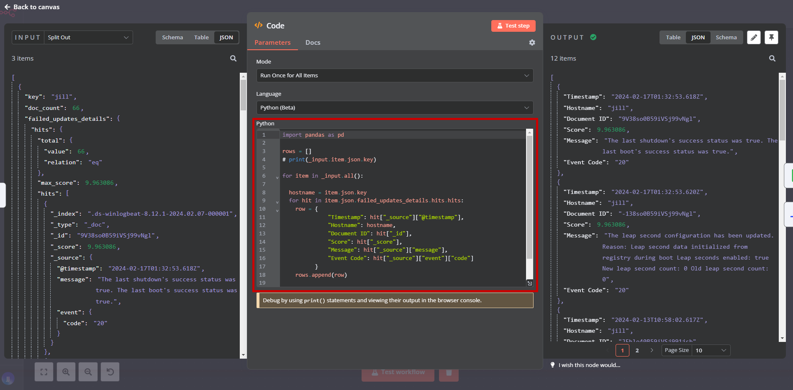

And then you can see from the output it is nicely formatted into the information that we want. Now all we have to do is convert it into a CSV!! 

4 and 5. Before we  do that we can store a backup of this on google drive as well, which is the same process as before, and we still have to convert it in order for it to be eligible. 

1. Now we can send it off to google sheets, and you may notice there are new parameters you will have to set: 
    
    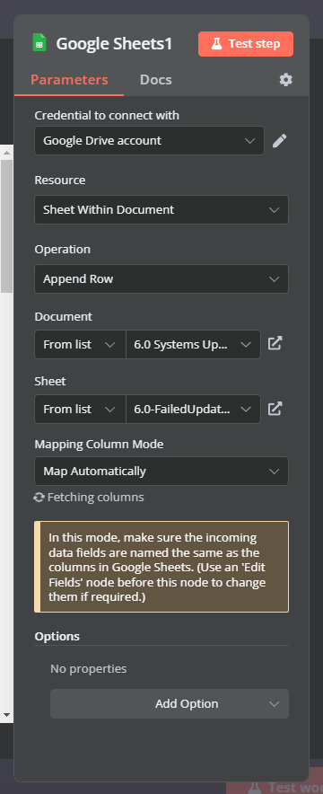
    

Then bam! You’re done, you have a google sheets that records all the failed updates on the network: 

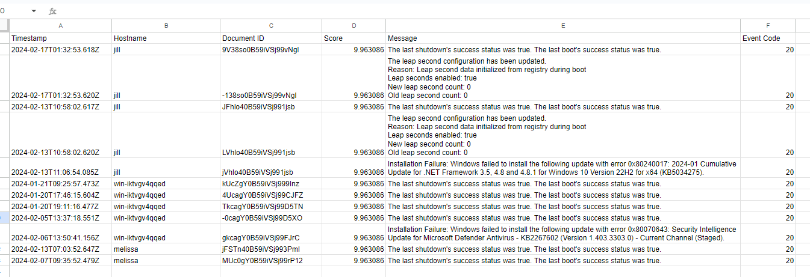
